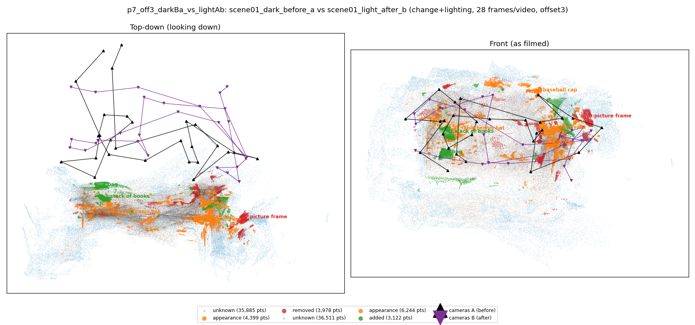
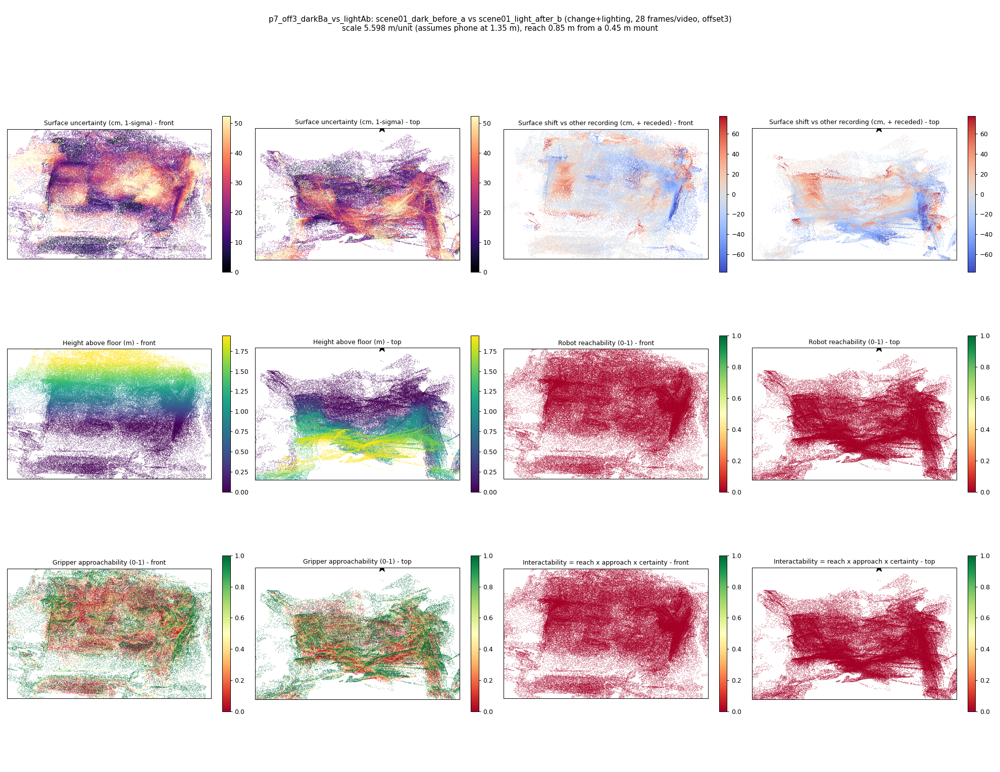

# p7_off3_darkBa_vs_lightAb

**scene01_dark_before_a** (A, before) vs **scene01_light_after_b** (B, after) - pair type **change+lighting**, 28 frames per video, variant `offset3`.

Distances are in cm, from a floor fit and an assumed phone height (scale 5.5978 m/unit, range [4.5612, 6.6345]).

| Measure | Value |
|---|---|
| Observed share (A / B) | 87.9% / 87.7% |
| Changed share of observed points (A / B) | 3.20% / 3.59% |
| Alignment residual across / within recordings | 0.0565 / 0.0528 |
| Thresholds (depth tau, see-through fraction, appearance) | 0.1585 / 0.66667 / 0.91136 |
| Changes (moved / removed / added / appearance) | 0 / 1 / 2 / 5 |
| Reconstruction time | 27.3 s (GPU peak 9.57 GB) |

Heat maps (recording B): reachable 0%, approachable 39%, interactable 0%; surface uncertainty median 17.132 cm (90th pct 43.816); surface shift 99th pct 77.862 cm.

## Changes

- **5 appearance** glass vase (p=0.902, 1341 pts, centroid +/- 0.036): The glass vase looks different (turned over, deformed or swapped) but occupies the same place.
- **6 appearance** shoe (p=0.183, 1143 pts, centroid +/- 0.036): The shoe looks different (turned over, deformed or swapped) but occupies the same place.
- **3 added** stack of books (p=0.716, 932 pts, centroid +/- 0.036): A stack of books appears in the second recording that was not there before.
- **4 added** bag (p=0.219, 857 pts, centroid +/- 0.036): A bag appears in the second recording that was not there before.
- **0 removed** picture frame (p=0.247, 839 pts, centroid +/- 0.036): A picture frame that was there in the first recording is no longer there.
- **2 appearance** baseball cap (p=0.621, 702 pts, centroid +/- 0.036): The baseball cap looks different (turned over, deformed or swapped) but occupies the same place.
- **7 appearance** door (p=0.172, 683 pts, centroid +/- 0.036): The door looks different (turned over, deformed or swapped) but occupies the same place.
- **1 appearance** table tennis bat (p=0.996, 639 pts, centroid +/- 0.036): The table tennis bat looks different (turned over, deformed or swapped) but occupies the same place.
