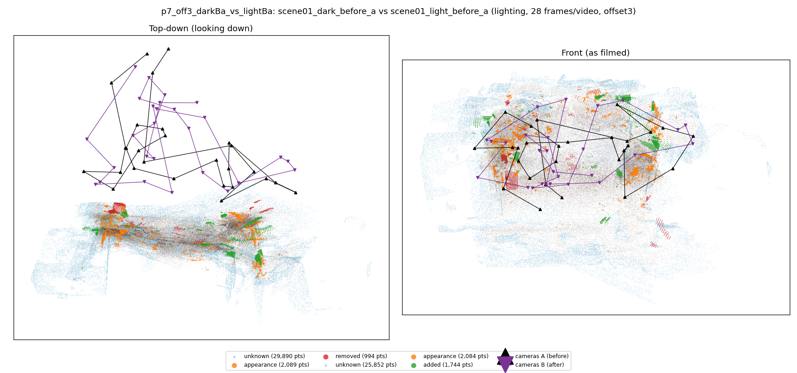
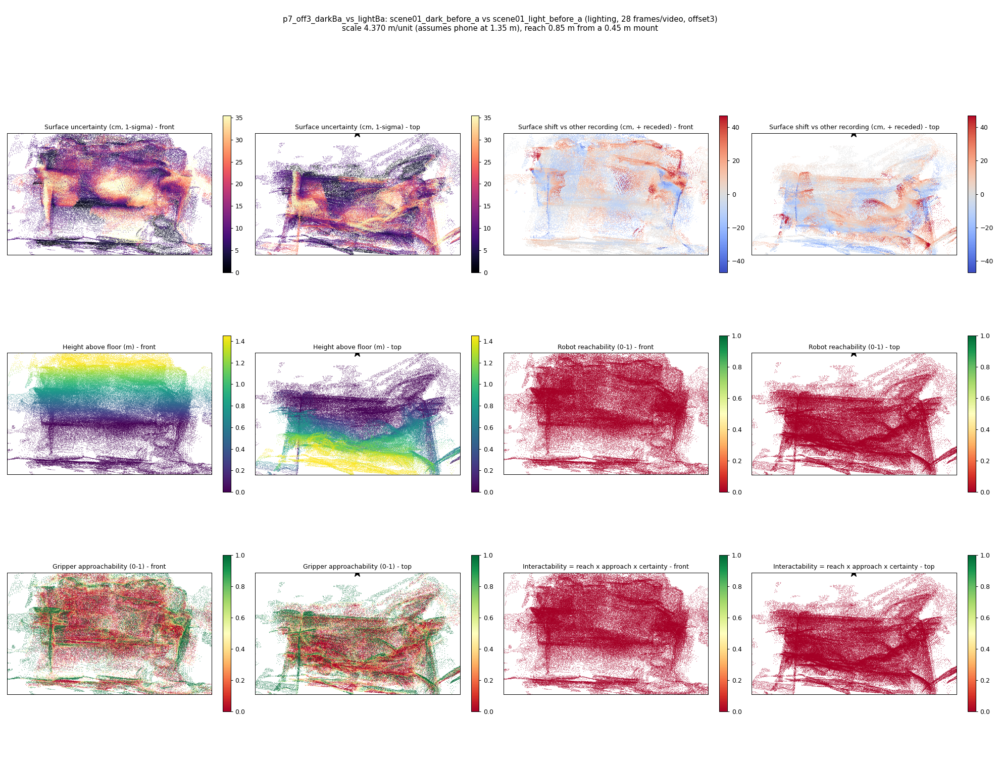

# p7_off3_darkBa_vs_lightBa

**scene01_dark_before_a** (A, before) vs **scene01_light_before_a** (B, after) - pair type **lighting**, 28 frames per video, variant `offset3`.

Distances are in cm, from a floor fit and an assumed phone height (scale 4.3703 m/unit, range [3.561, 5.1796]).

| Measure | Value |
|---|---|
| Observed share (A / B) | 90.0% / 91.3% |
| Changed share of observed points (A / B) | 1.15% / 1.41% |
| Alignment residual across / within recordings | 0.0377 / 0.0377 |
| Thresholds (depth tau, see-through fraction, appearance) | 0.11291 / 0.83333 / 0.91081 |
| Changes (moved / removed / added / appearance) | 0 / 0 / 0 / 0 |
| Reconstruction time | 27.9 s (GPU peak 9.57 GB) |

Nothing was moved between these recordings, so every flagged point is a false change: **false-change rate 1.28%**.

Heat maps (recording B): reachable 0%, approachable 28%, interactable 0%; surface uncertainty median 9.162 cm (90th pct 28.537); surface shift 99th pct 46.693 cm.

## Changes

- none detected
