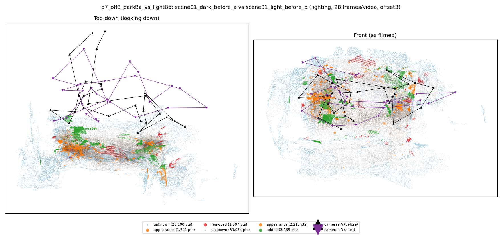
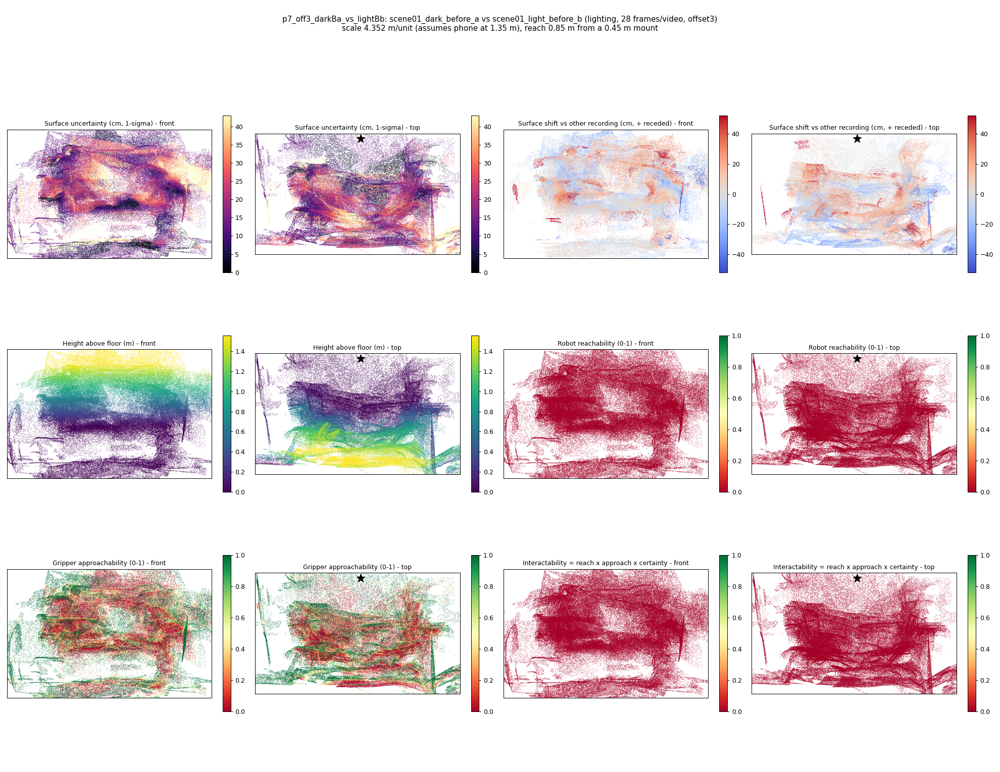

# p7_off3_darkBa_vs_lightBb

**scene01_dark_before_a** (A, before) vs **scene01_light_before_b** (B, after) - pair type **lighting**, 28 frames per video, variant `offset3`.

Distances are in cm, from a floor fit and an assumed phone height (scale 4.3518 m/unit, range [3.5459, 5.1576]).

| Measure | Value |
|---|---|
| Observed share (A / B) | 91.6% / 86.9% |
| Changed share of observed points (A / B) | 1.12% / 2.35% |
| Alignment residual across / within recordings | 0.0453 / 0.0459 |
| Thresholds (depth tau, see-through fraction, appearance) | 0.1371 / 0.71429 / 0.90447 |
| Changes (moved / removed / added / appearance) | 0 / 0 / 1 / 1 |
| Reconstruction time | 27.4 s (GPU peak 9.57 GB) |

Nothing was moved between these recordings, so every flagged point is a false change: **false-change rate 1.74%**.

Heat maps (recording B): reachable 0%, approachable 34%, interactable 0%; surface uncertainty median 13.538 cm (90th pct 33.76); surface shift 99th pct 51.924 cm.

## Changes

- **1 added** coaster (p=0.556, 1018 pts, centroid +/- 0.031): A coaster appears in the second recording that was not there before.
- **0 appearance** blanket (p=0.175, 619 pts, centroid +/- 0.031): The blanket looks different (turned over, deformed or swapped) but occupies the same place.
