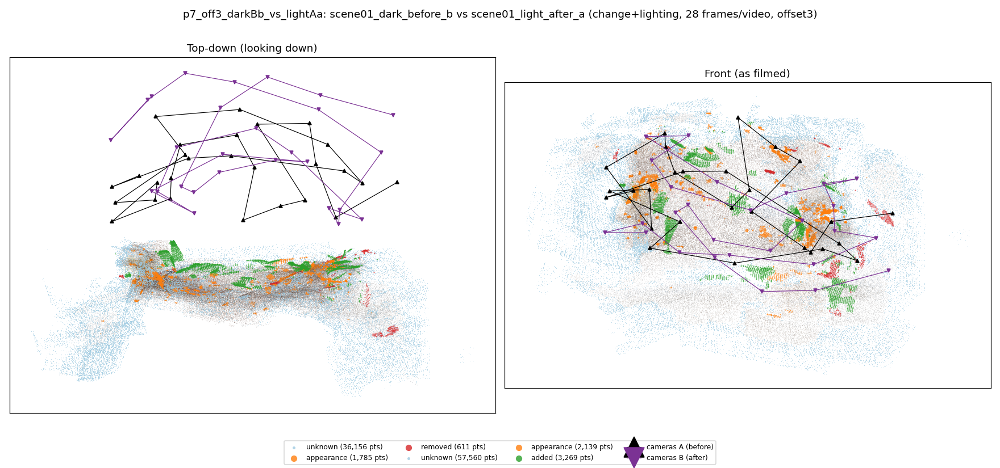
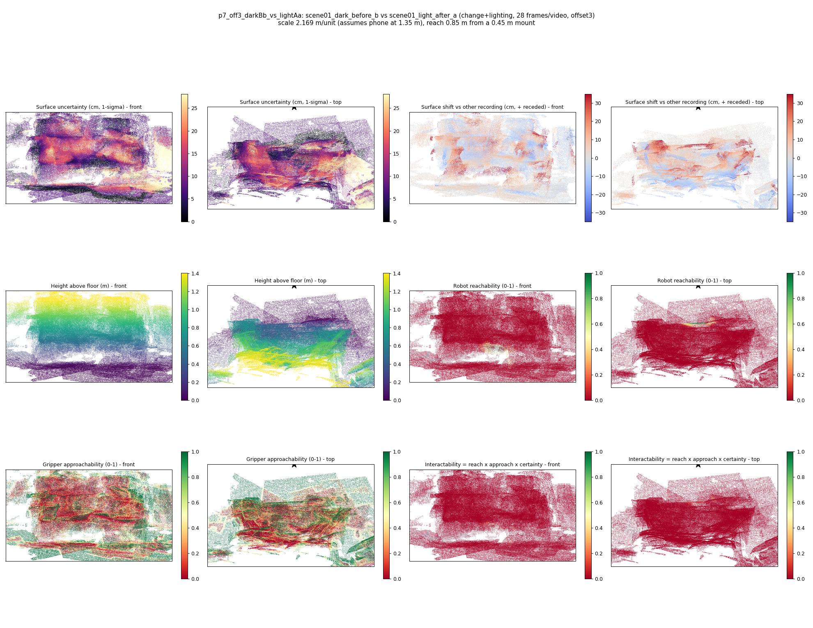

# p7_off3_darkBb_vs_lightAa

**scene01_dark_before_b** (A, before) vs **scene01_light_after_a** (B, after) - pair type **change+lighting**, 28 frames per video, variant `offset3`.

Distances are in cm, from a floor fit and an assumed phone height (scale 2.1686 m/unit, range [1.767, 2.5702]).

| Measure | Value |
|---|---|
| Observed share (A / B) | 87.8% / 80.6% |
| Changed share of observed points (A / B) | 0.92% / 2.26% |
| Alignment residual across / within recordings | 0.0406 / 0.0429 |
| Thresholds (depth tau, see-through fraction, appearance) | 0.12824 / 0.8 / 0.9249 |
| Changes (moved / removed / added / appearance) | 0 / 0 / 0 / 0 |
| Reconstruction time | 27.5 s (GPU peak 9.57 GB) |

Heat maps (recording B): reachable 0%, approachable 31%, interactable 0%; surface uncertainty median 7.757 cm (90th pct 21.768); surface shift 99th pct 34.755 cm.

## Changes

- none detected
