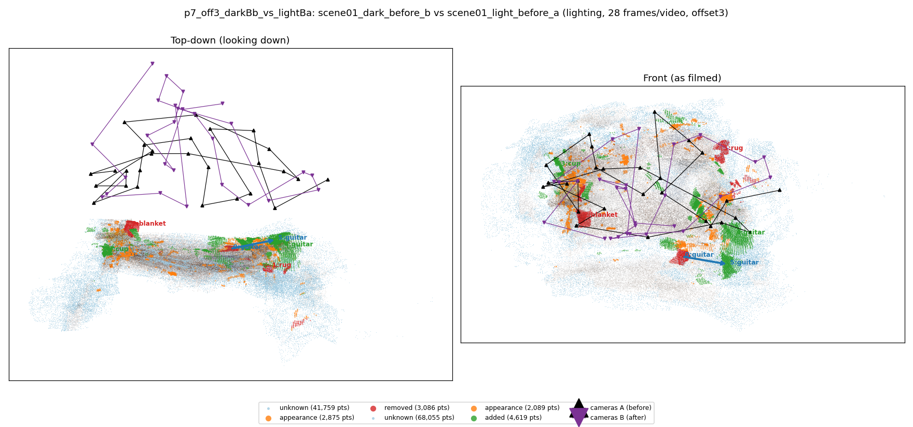
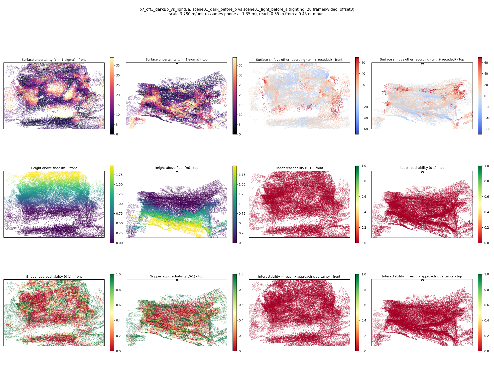

# p7_off3_darkBb_vs_lightBa

**scene01_dark_before_b** (A, before) vs **scene01_light_before_a** (B, after) - pair type **lighting**, 28 frames per video, variant `offset3`.

Distances are in cm, from a floor fit and an assumed phone height (scale 3.7803 m/unit, range [3.0802, 4.4804]).

| Measure | Value |
|---|---|
| Observed share (A / B) | 86.0% / 77.1% |
| Changed share of observed points (A / B) | 2.33% / 2.93% |
| Alignment residual across / within recordings | 0.0404 / 0.0366 |
| Thresholds (depth tau, see-through fraction, appearance) | 0.11051 / 0.8 / 0.91594 |
| Changes (moved / removed / added / appearance) | 1 / 2 / 2 / 0 |
| Reconstruction time | 27.4 s (GPU peak 9.57 GB) |

Nothing was moved between these recordings, so every flagged point is a false change: **false-change rate 2.63%**.

Heat maps (recording B): reachable 0%, approachable 30%, interactable 0%; surface uncertainty median 7.9 cm (90th pct 30.06); surface shift 99th pct 69.421 cm.

## Changes

- **4 added** guitar (p=0.909, 988 pts, centroid +/- 0.034): A guitar appears in the second recording that was not there before.
- **2 removed** blanket (p=0.066, 969 pts, centroid +/- 0.034): A blanket that was there in the first recording is no longer there.
- **5 moved** guitar (p=0.966, 826 pts, centroid +/- 0.034, 90% interval 0.19-0.35): The guitar moved to the right by about 102.18 cm (90% interval 71.80 to 132.55).
- **1 removed** rug (p=0.144, 661 pts, centroid +/- 0.034): A rug that was there in the first recording is no longer there.
- **3 added** cup (p=0.062, 660 pts, centroid +/- 0.034): A cup appears in the second recording that was not there before.
