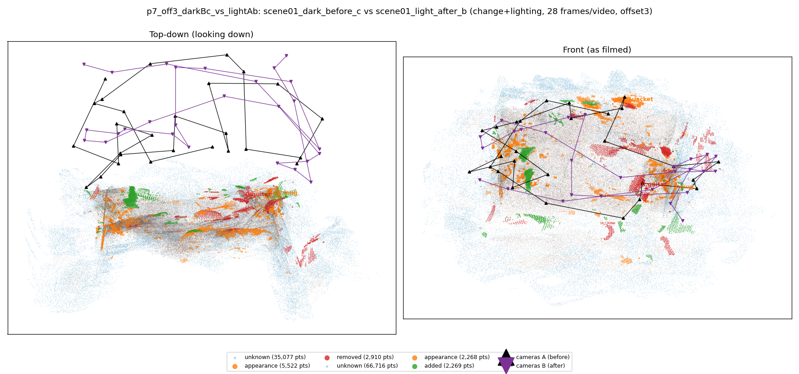
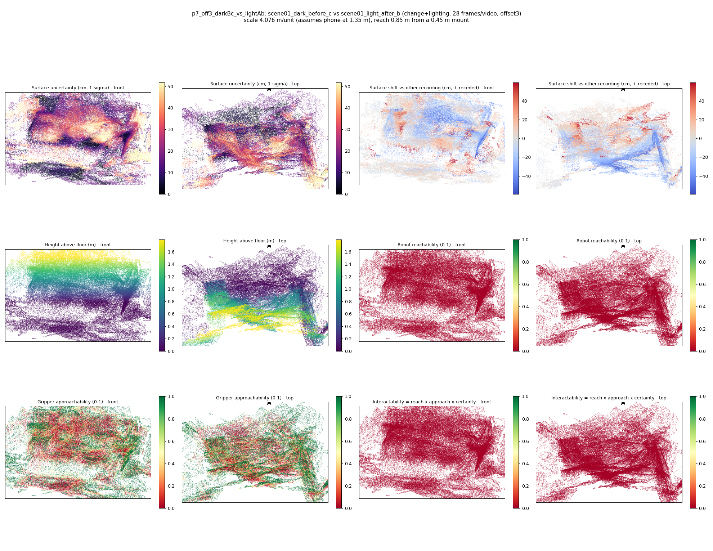

# p7_off3_darkBc_vs_lightAb

**scene01_dark_before_c** (A, before) vs **scene01_light_after_b** (B, after) - pair type **change+lighting**, 28 frames per video, variant `offset3`.

Distances are in cm, from a floor fit and an assumed phone height (scale 4.0765 m/unit, range [3.3216, 4.8314]).

| Measure | Value |
|---|---|
| Observed share (A / B) | 88.2% / 77.6% |
| Changed share of observed points (A / B) | 3.21% / 1.97% |
| Alignment residual across / within recordings | 0.0608 / 0.0546 |
| Thresholds (depth tau, see-through fraction, appearance) | 0.16363 / 0.66667 / 0.90945 |
| Changes (moved / removed / added / appearance) | 0 / 1 / 0 / 2 |
| Reconstruction time | 27.0 s (GPU peak 9.57 GB) |

Heat maps (recording B): reachable 0%, approachable 40%, interactable 0%; surface uncertainty median 16.229 cm (90th pct 44.225); surface shift 99th pct 59.422 cm.

## Changes

- **2 appearance** mug (p=0.526, 1243 pts, centroid +/- 0.048): The mug looks different (turned over, deformed or swapped) but occupies the same place.
- **1 appearance** jacket (p=0.686, 724 pts, centroid +/- 0.048): The jacket looks different (turned over, deformed or swapped) but occupies the same place.
- **0 removed** guitar (p=0.556, 598 pts, centroid +/- 0.048): A guitar that was there in the first recording is no longer there.
