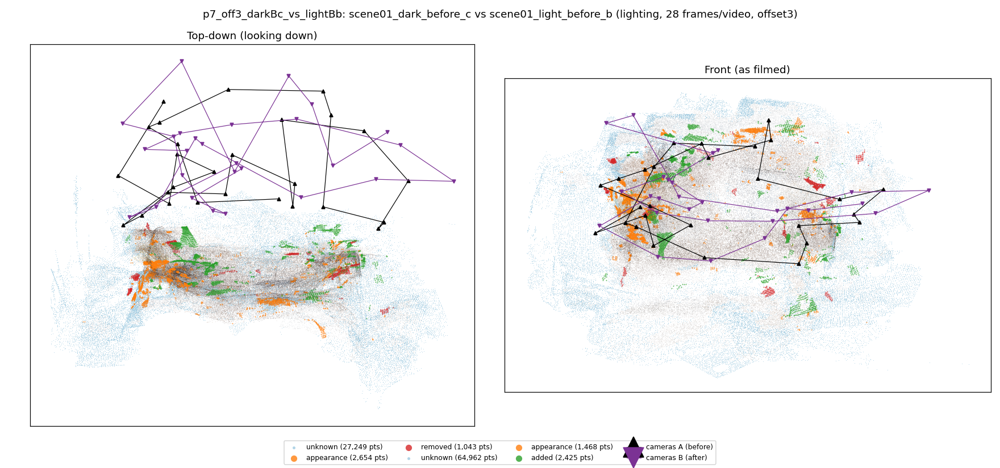
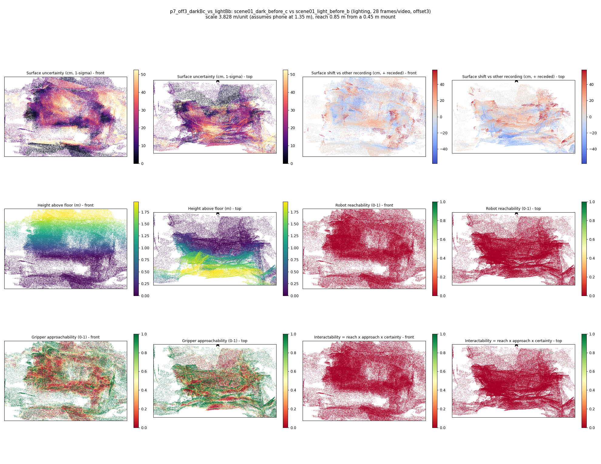

# p7_off3_darkBc_vs_lightBb

**scene01_dark_before_c** (A, before) vs **scene01_light_before_b** (B, after) - pair type **lighting**, 28 frames per video, variant `offset3`.

Distances are in cm, from a floor fit and an assumed phone height (scale 3.828 m/unit, range [3.1191, 4.5369]).

| Measure | Value |
|---|---|
| Observed share (A / B) | 90.8% / 78.1% |
| Changed share of observed points (A / B) | 1.37% / 1.68% |
| Alignment residual across / within recordings | 0.0499 / 0.0497 |
| Thresholds (depth tau, see-through fraction, appearance) | 0.14955 / 0.66667 / 0.91318 |
| Changes (moved / removed / added / appearance) | 0 / 0 / 0 / 0 |
| Reconstruction time | 27.2 s (GPU peak 9.57 GB) |

Nothing was moved between these recordings, so every flagged point is a false change: **false-change rate 1.52%**.

Heat maps (recording B): reachable 0%, approachable 40%, interactable 0%; surface uncertainty median 15.484 cm (90th pct 43.273); surface shift 99th pct 58.101 cm.

## Changes

- none detected
