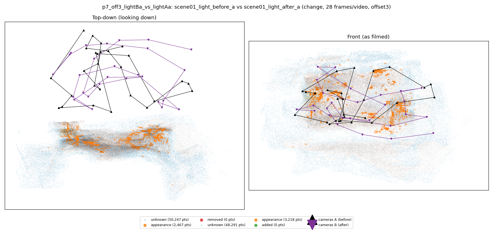
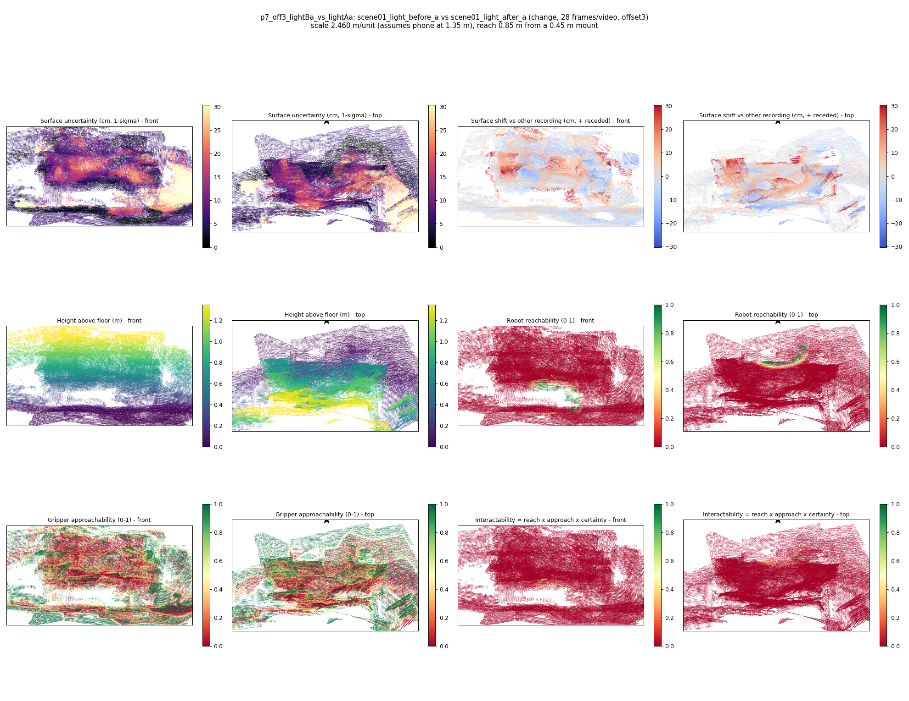

# p7_off3_lightBa_vs_lightAa

**scene01_light_before_a** (A, before) vs **scene01_light_after_a** (B, after) - pair type **change**, 28 frames per video, variant `offset3`.

Distances are in cm, from a floor fit and an assumed phone height (scale 2.4603 m/unit, range [2.0047, 2.9159]).

| Measure | Value |
|---|---|
| Observed share (A / B) | 83.1% / 83.8% |
| Changed share of observed points (A / B) | 1.00% / 1.29% |
| Alignment residual across / within recordings | 0.0326 / 0.0308 |
| Thresholds (depth tau, see-through fraction, appearance) | 0.09215 / 1.0 / 0.9 |
| Changes (moved / removed / added / appearance) | 0 / 0 / 0 / 0 |
| Reconstruction time | 28.6 s (GPU peak 9.57 GB) |

Heat maps (recording B): reachable 1%, approachable 33%, interactable 0%; surface uncertainty median 5.874 cm (90th pct 21.704); surface shift 99th pct 30.241 cm.

## Changes

- none detected
