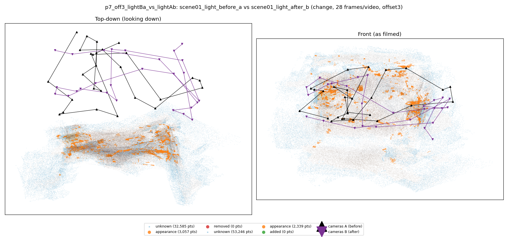
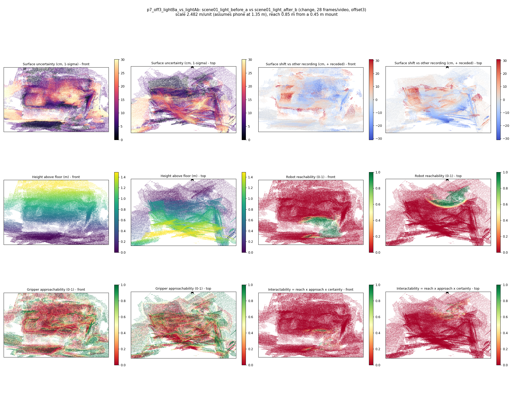

# p7_off3_lightBa_vs_lightAb

**scene01_light_before_a** (A, before) vs **scene01_light_after_b** (B, after) - pair type **change**, 28 frames per video, variant `offset3`.

Distances are in cm, from a floor fit and an assumed phone height (scale 2.482 m/unit, range [2.0224, 2.9417]).

| Measure | Value |
|---|---|
| Observed share (A / B) | 89.1% / 82.1% |
| Changed share of observed points (A / B) | 1.15% / 0.96% |
| Alignment residual across / within recordings | 0.044 / 0.0383 |
| Thresholds (depth tau, see-through fraction, appearance) | 0.1147 / 1.0 / 0.89282 |
| Changes (moved / removed / added / appearance) | 0 / 0 / 0 / 0 |
| Reconstruction time | 27.4 s (GPU peak 9.57 GB) |

Heat maps (recording B): reachable 5%, approachable 31%, interactable 1%; surface uncertainty median 8.045 cm (90th pct 26.214); surface shift 99th pct 30.851 cm.

## Changes

- none detected
