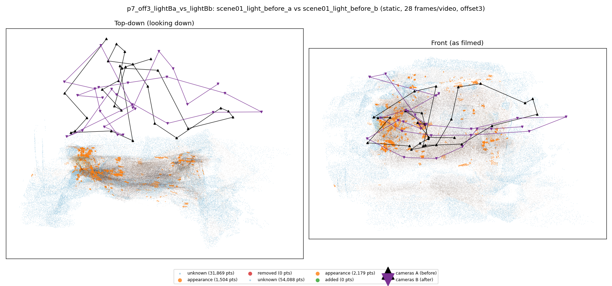
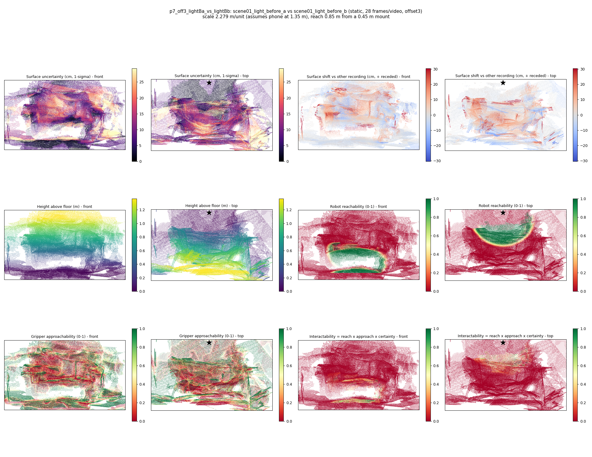

# p7_off3_lightBa_vs_lightBb

**scene01_light_before_a** (A, before) vs **scene01_light_before_b** (B, after) - pair type **static**, 28 frames per video, variant `offset3`.

Distances are in cm, from a floor fit and an assumed phone height (scale 2.2791 m/unit, range [1.8571, 2.7012]).

| Measure | Value |
|---|---|
| Observed share (A / B) | 89.3% / 81.8% |
| Changed share of observed points (A / B) | 0.57% / 0.90% |
| Alignment residual across / within recordings | 0.0364 / 0.0361 |
| Thresholds (depth tau, see-through fraction, appearance) | 0.10897 / 1.0 / 0.90527 |
| Changes (moved / removed / added / appearance) | 0 / 0 / 0 / 0 |
| Reconstruction time | 26.9 s (GPU peak 9.57 GB) |

Nothing was moved between these recordings, so every flagged point is a false change: **false-change rate 0.73%**.

Heat maps (recording B): reachable 14%, approachable 32%, interactable 1%; surface uncertainty median 8.192 cm (90th pct 23.772); surface shift 99th pct 30.387 cm.

## Changes

- none detected
