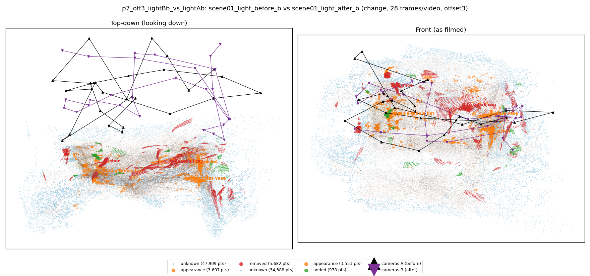
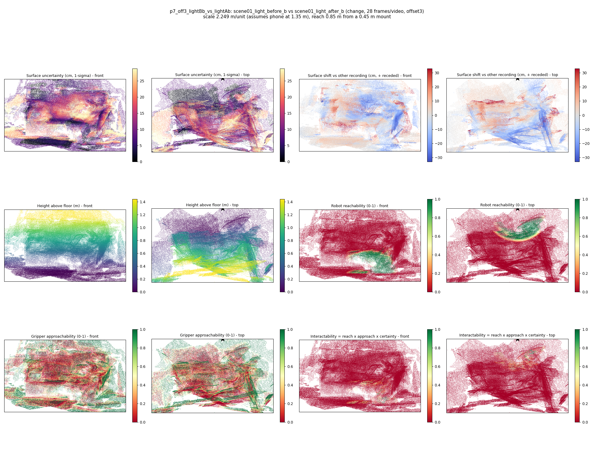

# p7_off3_lightBb_vs_lightAb

**scene01_light_before_b** (A, before) vs **scene01_light_after_b** (B, after) - pair type **change**, 28 frames per video, variant `offset3`.

Distances are in cm, from a floor fit and an assumed phone height (scale 2.249 m/unit, range [1.8325, 2.6654]).

| Measure | Value |
|---|---|
| Observed share (A / B) | 83.9% / 88.4% |
| Changed share of observed points (A / B) | 3.76% / 1.72% |
| Alignment residual across / within recordings | 0.0561 / 0.0524 |
| Thresholds (depth tau, see-through fraction, appearance) | 0.15815 / 0.8 / 0.91504 |
| Changes (moved / removed / added / appearance) | 0 / 2 / 0 / 3 |
| Reconstruction time | 27.1 s (GPU peak 9.57 GB) |

Heat maps (recording B): reachable 6%, approachable 32%, interactable 0%; surface uncertainty median 8.205 cm (90th pct 24.987); surface shift 99th pct 32.915 cm.

## Changes

- **4 appearance** jacket (p=0.141, 1772 pts, centroid +/- 0.051): The jacket looks different (turned over, deformed or swapped) but occupies the same place.
- **0 removed** baseball cap (p=0.539, 1727 pts, centroid +/- 0.051): A baseball cap that was there in the first recording is no longer there.
- **2 appearance** table tennis bat (p=0.595, 777 pts, centroid +/- 0.051): The table tennis bat looks different (turned over, deformed or swapped) but occupies the same place.
- **3 appearance** glass vase (p=0.934, 655 pts, centroid +/- 0.051): The glass vase looks different (turned over, deformed or swapped) but occupies the same place.
- **1 removed** shoe (p=0.323, 598 pts, centroid +/- 0.051): A shoe that was there in the first recording is no longer there.
