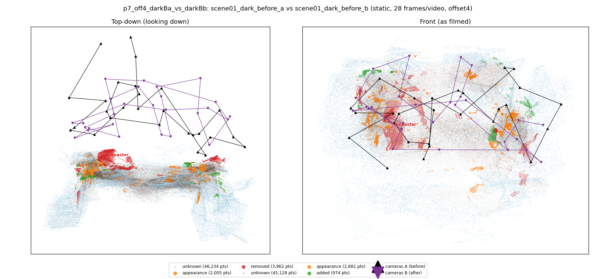
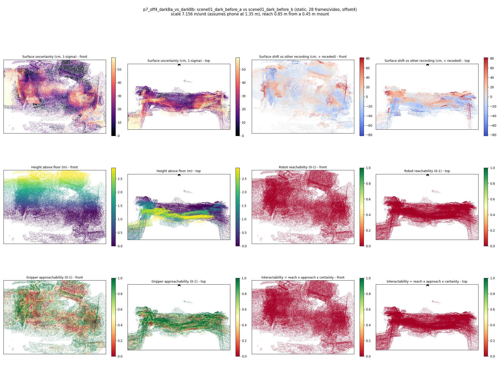

# p7_off4_darkBa_vs_darkBb

**scene01_dark_before_a** (A, before) vs **scene01_dark_before_b** (B, after) - pair type **static**, 28 frames per video, variant `offset4`.

Distances are in cm, from a floor fit and an assumed phone height (scale 7.1564 m/unit, range [5.8311, 8.4816]).

| Measure | Value |
|---|---|
| Observed share (A / B) | 85.1% / 85.7% |
| Changed share of observed points (A / B) | 2.27% / 1.43% |
| Alignment residual across / within recordings | 0.0512 / 0.0504 |
| Thresholds (depth tau, see-through fraction, appearance) | 0.15184 / 0.8 / 0.90747 |
| Changes (moved / removed / added / appearance) | 0 / 1 / 0 / 0 |
| Reconstruction time | 27.4 s (GPU peak 9.57 GB) |

Nothing was moved between these recordings, so every flagged point is a false change: **false-change rate 1.85%**.

Heat maps (recording B): reachable 0%, approachable 47%, interactable 0%; surface uncertainty median 16.995 cm (90th pct 46.213); surface shift 99th pct 81.73 cm.

## Changes

- **0 removed** coaster (p=0.277, 1866 pts, centroid +/- 0.035): A coaster that was there in the first recording is no longer there.
