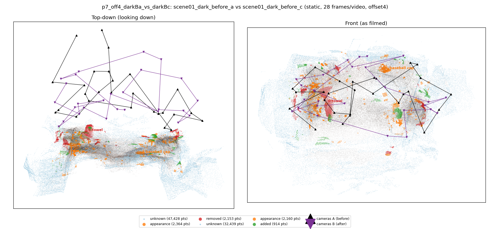
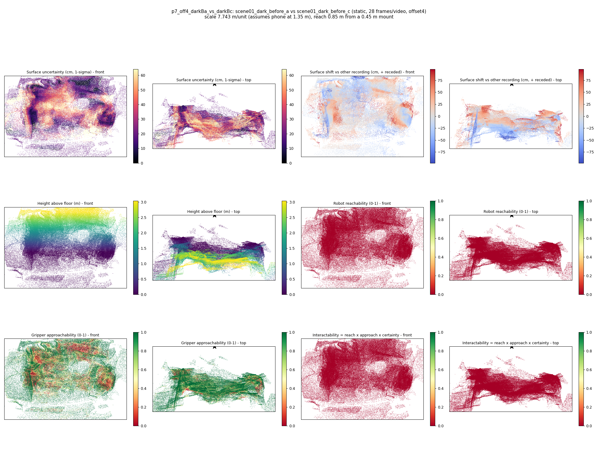

# p7_off4_darkBa_vs_darkBc

**scene01_dark_before_a** (A, before) vs **scene01_dark_before_c** (B, after) - pair type **static**, 28 frames per video, variant `offset4`.

Distances are in cm, from a floor fit and an assumed phone height (scale 7.7428 m/unit, range [6.309, 9.1767]).

| Measure | Value |
|---|---|
| Observed share (A / B) | 84.7% / 89.5% |
| Changed share of observed points (A / B) | 1.72% / 1.11% |
| Alignment residual across / within recordings | 0.0574 / 0.0543 |
| Thresholds (depth tau, see-through fraction, appearance) | 0.16296 / 0.75 / 0.91467 |
| Changes (moved / removed / added / appearance) | 0 / 1 / 0 / 1 |
| Reconstruction time | 27.4 s (GPU peak 9.57 GB) |

Nothing was moved between these recordings, so every flagged point is a false change: **false-change rate 1.42%**.

Heat maps (recording B): reachable 0%, approachable 53%, interactable 0%; surface uncertainty median 19.924 cm (90th pct 50.877); surface shift 99th pct 98.087 cm.

## Changes

- **0 removed** towel (p=0.315, 878 pts, centroid +/- 0.035): A towel that was there in the first recording is no longer there.
- **1 appearance** baseball cap (p=0.463, 659 pts, centroid +/- 0.035): The baseball cap looks different (turned over, deformed or swapped) but occupies the same place.
