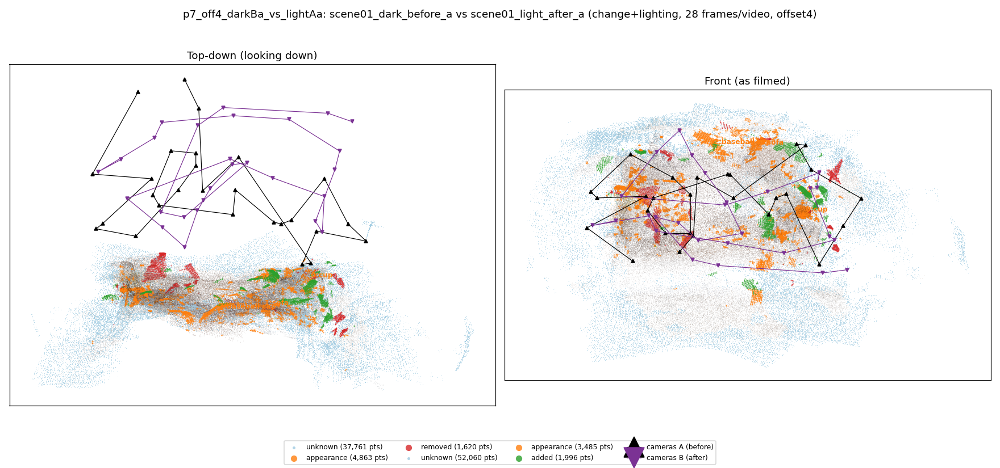
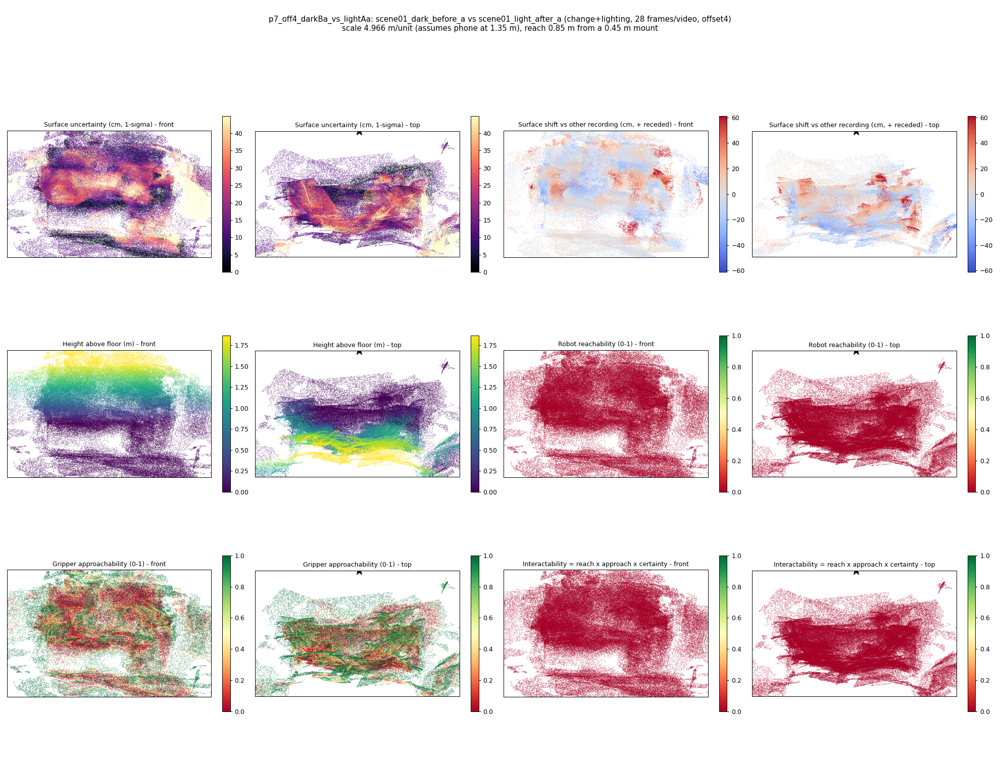

# p7_off4_darkBa_vs_lightAa

**scene01_dark_before_a** (A, before) vs **scene01_light_after_a** (B, after) - pair type **change+lighting**, 28 frames per video, variant `offset4`.

Distances are in cm, from a floor fit and an assumed phone height (scale 4.9661 m/unit, range [4.0464, 5.8857]).

| Measure | Value |
|---|---|
| Observed share (A / B) | 87.3% / 82.5% |
| Changed share of observed points (A / B) | 2.50% / 2.23% |
| Alignment residual across / within recordings | 0.0437 / 0.0431 |
| Thresholds (depth tau, see-through fraction, appearance) | 0.12894 / 0.875 / 0.89941 |
| Changes (moved / removed / added / appearance) | 0 / 0 / 0 / 3 |
| Reconstruction time | 27.1 s (GPU peak 9.57 GB) |

Heat maps (recording B): reachable 0%, approachable 36%, interactable 0%; surface uncertainty median 13.019 cm (90th pct 34.306); surface shift 99th pct 61.199 cm.

## Changes

- **0 appearance** cup (p=0.78, 1055 pts, centroid +/- 0.032): The cup looks different (turned over, deformed or swapped) but occupies the same place.
- **1 appearance** sofa (p=0.163, 777 pts, centroid +/- 0.032): The sofa looks different (turned over, deformed or swapped) but occupies the same place.
- **2 appearance** baseball cap (p=0.804, 597 pts, centroid +/- 0.032): The baseball cap looks different (turned over, deformed or swapped) but occupies the same place.
