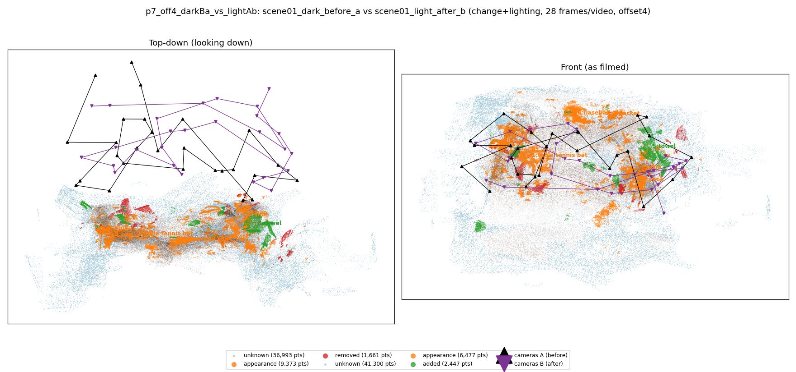
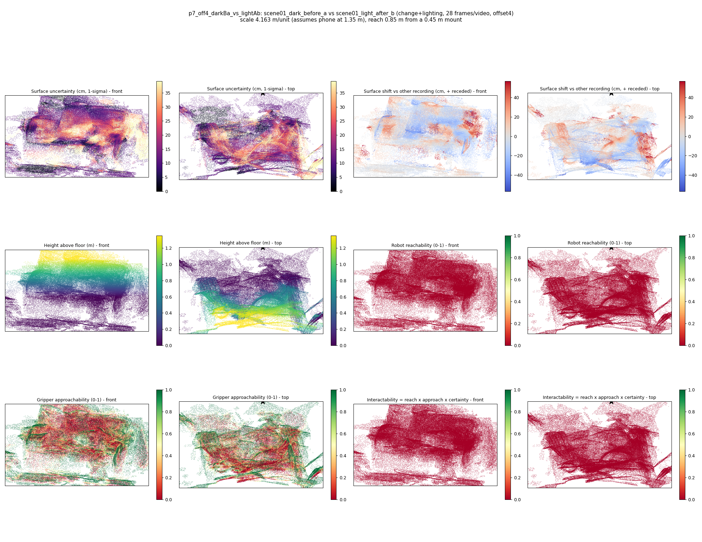

# p7_off4_darkBa_vs_lightAb

**scene01_dark_before_a** (A, before) vs **scene01_light_after_b** (B, after) - pair type **change+lighting**, 28 frames per video, variant `offset4`.

Distances are in cm, from a floor fit and an assumed phone height (scale 4.1626 m/unit, range [3.3918, 4.9335]).

| Measure | Value |
|---|---|
| Observed share (A / B) | 87.6% / 86.1% |
| Changed share of observed points (A / B) | 4.24% / 3.48% |
| Alignment residual across / within recordings | 0.056 / 0.0511 |
| Thresholds (depth tau, see-through fraction, appearance) | 0.15261 / 0.75 / 0.89707 |
| Changes (moved / removed / added / appearance) | 0 / 0 / 1 / 7 |
| Reconstruction time | 27.1 s (GPU peak 9.57 GB) |

Heat maps (recording B): reachable 0%, approachable 32%, interactable 0%; surface uncertainty median 11.866 cm (90th pct 32.569); surface shift 99th pct 56.625 cm.

## Changes

- **1 appearance** table tennis bat (p=0.972, 1892 pts, centroid +/- 0.037): The table tennis bat looks different (turned over, deformed or swapped) but occupies the same place.
- **2 appearance** bag (p=0.477, 1870 pts, centroid +/- 0.037): The bag looks different (turned over, deformed or swapped) but occupies the same place.
- **6 appearance** baseball cap (p=0.716, 1796 pts, centroid +/- 0.037): The baseball cap looks different (turned over, deformed or swapped) but occupies the same place.
- **7 appearance** shoe (p=0.26, 1166 pts, centroid +/- 0.037): The shoe looks different (turned over, deformed or swapped) but occupies the same place.
- **5 added** towel (p=0.129, 1064 pts, centroid +/- 0.037): A towel appears in the second recording that was not there before.
- **0 appearance** book (p=0.832, 1050 pts, centroid +/- 0.037): The book looks different (turned over, deformed or swapped) but occupies the same place.
- **4 appearance** jacket (p=0.223, 768 pts, centroid +/- 0.037): The jacket looks different (turned over, deformed or swapped) but occupies the same place.
- **3 appearance** cup (p=0.573, 649 pts, centroid +/- 0.037): The cup looks different (turned over, deformed or swapped) but occupies the same place.
