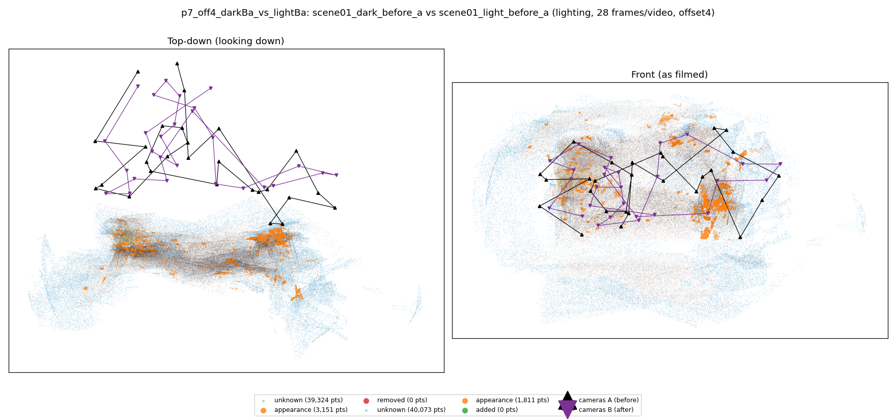
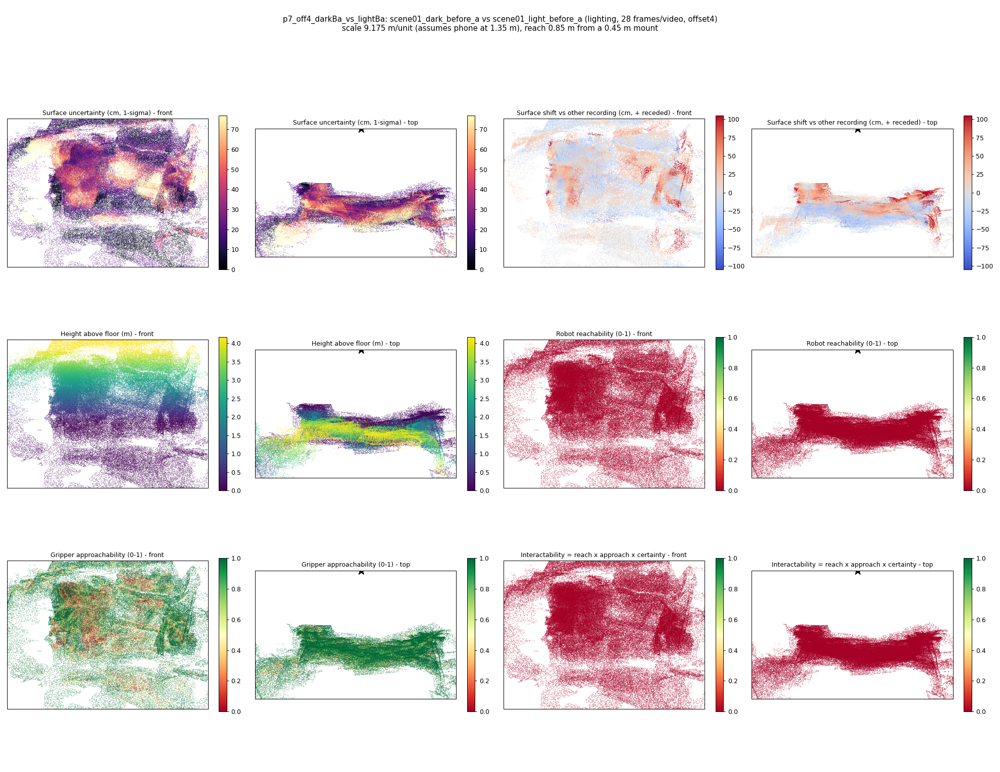

# p7_off4_darkBa_vs_lightBa

**scene01_dark_before_a** (A, before) vs **scene01_light_before_a** (B, after) - pair type **lighting**, 28 frames per video, variant `offset4`.

Distances are in cm, from a floor fit and an assumed phone height (scale 9.1754 m/unit, range [7.4763, 10.8746]).

| Measure | Value |
|---|---|
| Observed share (A / B) | 86.8% / 86.5% |
| Changed share of observed points (A / B) | 1.22% / 0.70% |
| Alignment residual across / within recordings | 0.0394 / 0.0389 |
| Thresholds (depth tau, see-through fraction, appearance) | 0.11697 / 1.0 / 0.89872 |
| Changes (moved / removed / added / appearance) | 0 / 0 / 0 / 1 |
| Reconstruction time | 27.6 s (GPU peak 9.57 GB) |

Nothing was moved between these recordings, so every flagged point is a false change: **false-change rate 0.96%**.

Heat maps (recording B): reachable 0%, approachable 61%, interactable 0%; surface uncertainty median 20.854 cm (90th pct 57.154); surface shift 99th pct 104.806 cm.

## Changes

- **0 appearance** guitar (p=0.989, 782 pts, centroid +/- 0.028): The guitar looks different (turned over, deformed or swapped) but occupies the same place.
