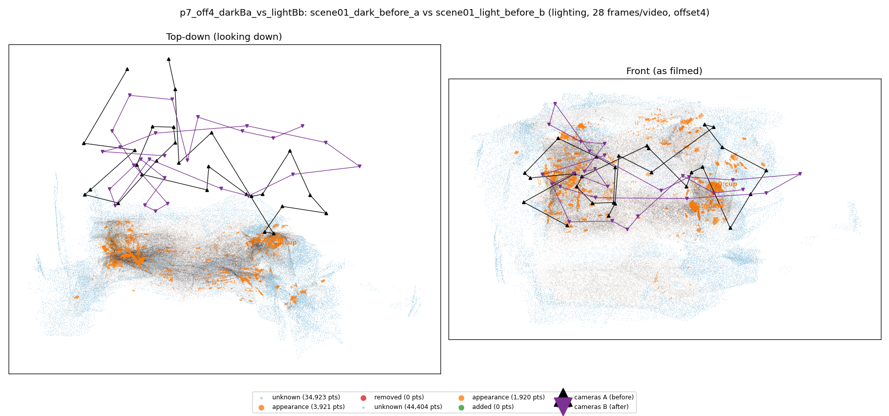
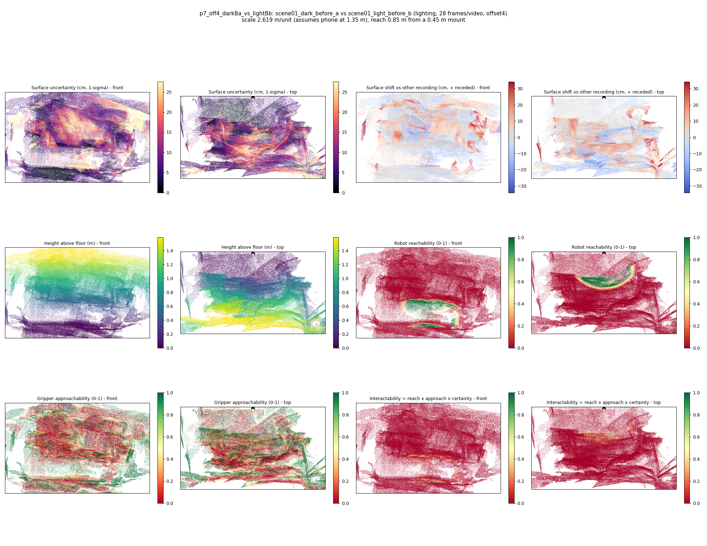

# p7_off4_darkBa_vs_lightBb

**scene01_dark_before_a** (A, before) vs **scene01_light_before_b** (B, after) - pair type **lighting**, 28 frames per video, variant `offset4`.

Distances are in cm, from a floor fit and an assumed phone height (scale 2.619 m/unit, range [2.134, 3.104]).

| Measure | Value |
|---|---|
| Observed share (A / B) | 88.3% / 85.1% |
| Changed share of observed points (A / B) | 1.49% / 0.76% |
| Alignment residual across / within recordings | 0.0428 / 0.0427 |
| Thresholds (depth tau, see-through fraction, appearance) | 0.1283 / 1.0 / 0.89868 |
| Changes (moved / removed / added / appearance) | 0 / 0 / 0 / 2 |
| Reconstruction time | 27.3 s (GPU peak 9.57 GB) |

Nothing was moved between these recordings, so every flagged point is a false change: **false-change rate 1.12%**.

Heat maps (recording B): reachable 4%, approachable 30%, interactable 0%; surface uncertainty median 7.182 cm (90th pct 22.0); surface shift 99th pct 34.104 cm.

## Changes

- **1 appearance** guitar (p=0.993, 844 pts, centroid +/- 0.032): The guitar looks different (turned over, deformed or swapped) but occupies the same place.
- **0 appearance** cup (p=0.531, 677 pts, centroid +/- 0.032): The cup looks different (turned over, deformed or swapped) but occupies the same place.
