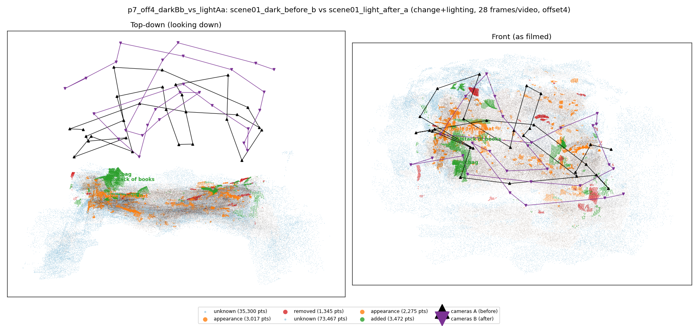
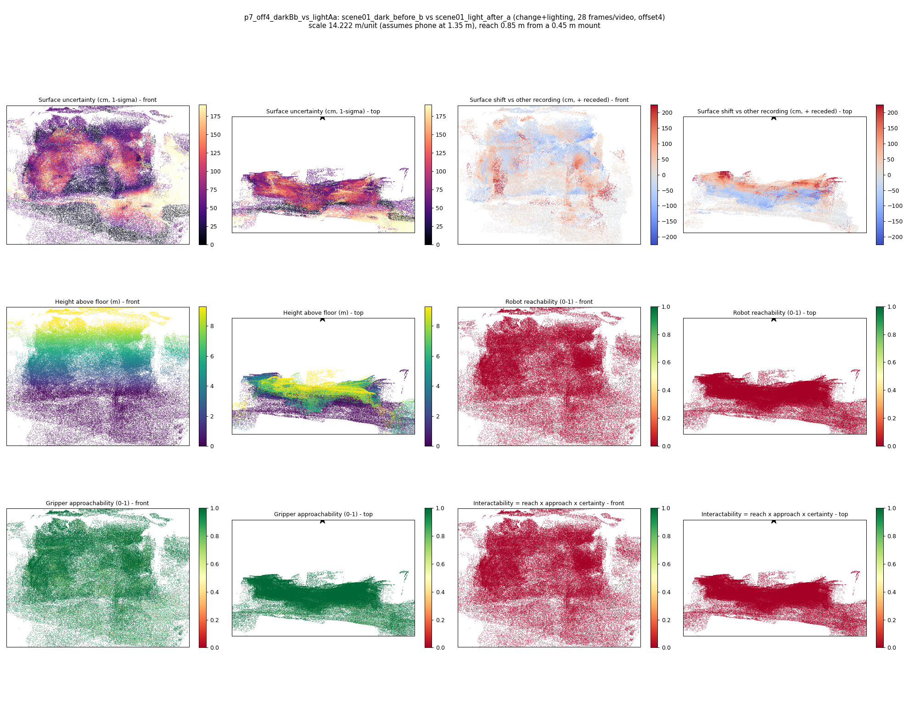

# p7_off4_darkBb_vs_lightAa

**scene01_dark_before_b** (A, before) vs **scene01_light_after_a** (B, after) - pair type **change+lighting**, 28 frames per video, variant `offset4`.

Distances are in cm, from a floor fit and an assumed phone height (scale 14.2225 m/unit, range [11.5887, 16.8562]).

| Measure | Value |
|---|---|
| Observed share (A / B) | 88.1% / 75.3% |
| Changed share of observed points (A / B) | 1.67% / 2.57% |
| Alignment residual across / within recordings | 0.0388 / 0.0398 |
| Thresholds (depth tau, see-through fraction, appearance) | 0.11933 / 0.83333 / 0.90698 |
| Changes (moved / removed / added / appearance) | 0 / 0 / 2 / 1 |
| Reconstruction time | 27.5 s (GPU peak 9.57 GB) |

Heat maps (recording B): reachable 0%, approachable 96%, interactable 0%; surface uncertainty median 56.841 cm (90th pct 141.068); surface shift 99th pct 224.953 cm.

## Changes

- **2 added** bag (p=0.131, 1096 pts, centroid +/- 0.044): A bag appears in the second recording that was not there before.
- **0 appearance** table tennis bat (p=0.201, 892 pts, centroid +/- 0.044): The table tennis bat looks different (turned over, deformed or swapped) but occupies the same place.
- **1 added** stack of books (p=0.677, 629 pts, centroid +/- 0.044): A stack of books appears in the second recording that was not there before.
