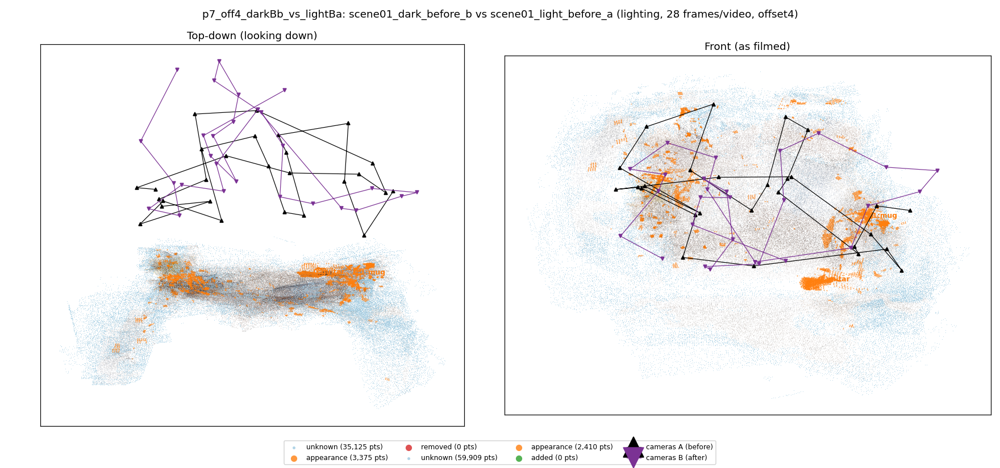
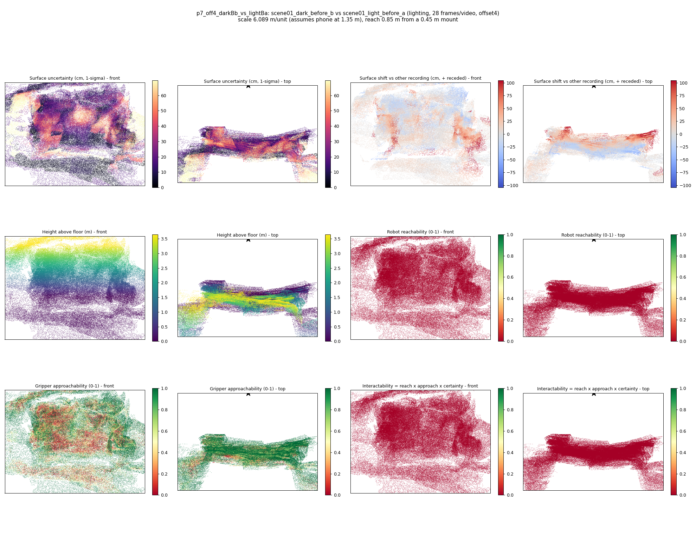

# p7_off4_darkBb_vs_lightBa

**scene01_dark_before_b** (A, before) vs **scene01_light_before_a** (B, after) - pair type **lighting**, 28 frames per video, variant `offset4`.

Distances are in cm, from a floor fit and an assumed phone height (scale 6.0895 m/unit, range [4.9618, 7.2171]).

| Measure | Value |
|---|---|
| Observed share (A / B) | 88.2% / 79.8% |
| Changed share of observed points (A / B) | 1.29% / 1.02% |
| Alignment residual across / within recordings | 0.0369 / 0.0349 |
| Thresholds (depth tau, see-through fraction, appearance) | 0.10466 / 1.0 / 0.89551 |
| Changes (moved / removed / added / appearance) | 0 / 0 / 0 / 2 |
| Reconstruction time | 27.3 s (GPU peak 9.57 GB) |

Nothing was moved between these recordings, so every flagged point is a false change: **false-change rate 1.15%**.

Heat maps (recording B): reachable 0%, approachable 52%, interactable 0%; surface uncertainty median 17.117 cm (90th pct 52.978); surface shift 99th pct 104.338 cm.

## Changes

- **0 appearance** guitar (p=0.988, 1022 pts, centroid +/- 0.035): The guitar looks different (turned over, deformed or swapped) but occupies the same place.
- **1 appearance** mug (p=0.55, 810 pts, centroid +/- 0.035): The mug looks different (turned over, deformed or swapped) but occupies the same place.
