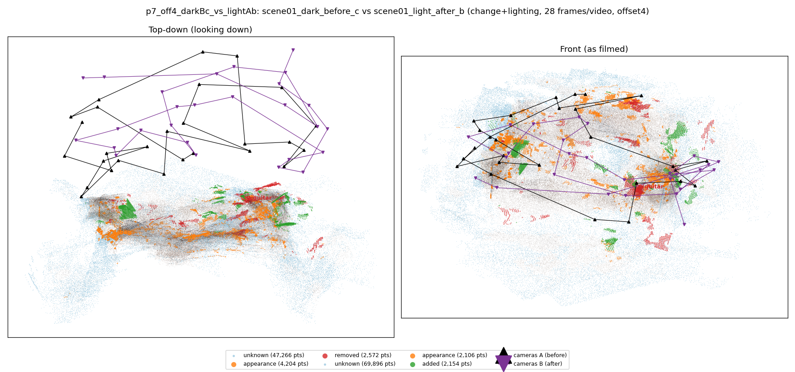
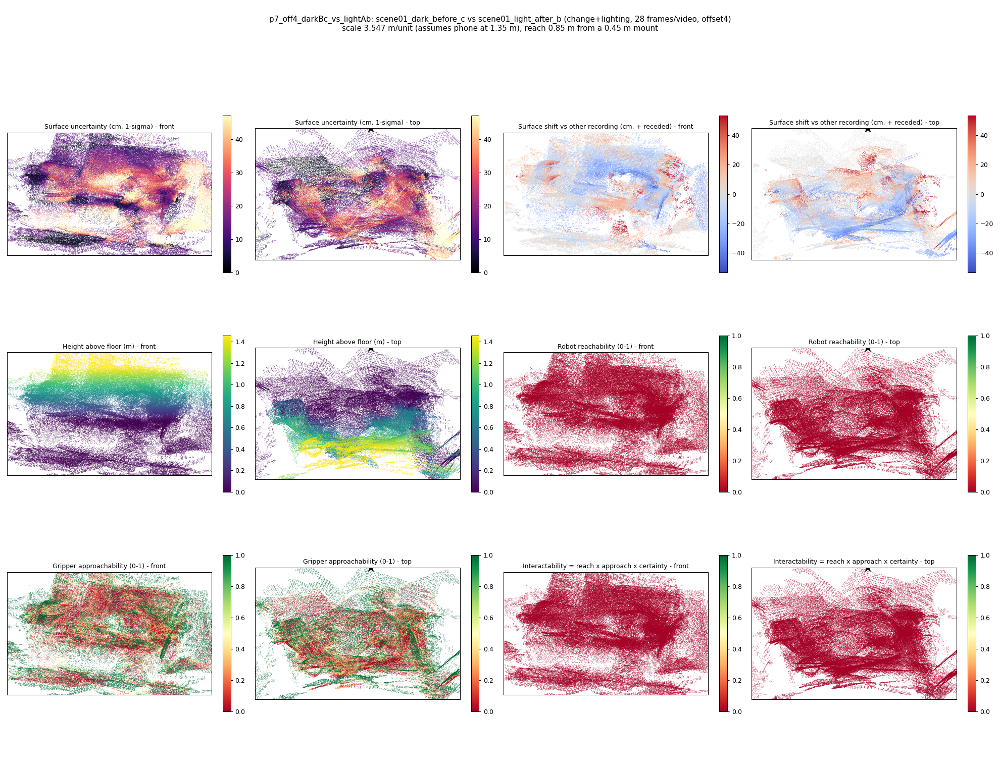

# p7_off4_darkBc_vs_lightAb

**scene01_dark_before_c** (A, before) vs **scene01_light_after_b** (B, after) - pair type **change+lighting**, 28 frames per video, variant `offset4`.

Distances are in cm, from a floor fit and an assumed phone height (scale 3.547 m/unit, range [2.8902, 4.2039]).

| Measure | Value |
|---|---|
| Observed share (A / B) | 84.1% / 76.5% |
| Changed share of observed points (A / B) | 2.71% / 1.87% |
| Alignment residual across / within recordings | 0.0503 / 0.0494 |
| Thresholds (depth tau, see-through fraction, appearance) | 0.14834 / 0.68333 / 0.91081 |
| Changes (moved / removed / added / appearance) | 0 / 1 / 0 / 1 |
| Reconstruction time | 27.1 s (GPU peak 9.57 GB) |

Heat maps (recording B): reachable 0%, approachable 36%, interactable 0%; surface uncertainty median 13.726 cm (90th pct 38.986); surface shift 99th pct 53.343 cm.

## Changes

- **1 appearance** bag (p=0.444, 992 pts, centroid +/- 0.048): The bag looks different (turned over, deformed or swapped) but occupies the same place.
- **0 removed** guitar (p=0.92, 852 pts, centroid +/- 0.048): A guitar that was there in the first recording is no longer there.
