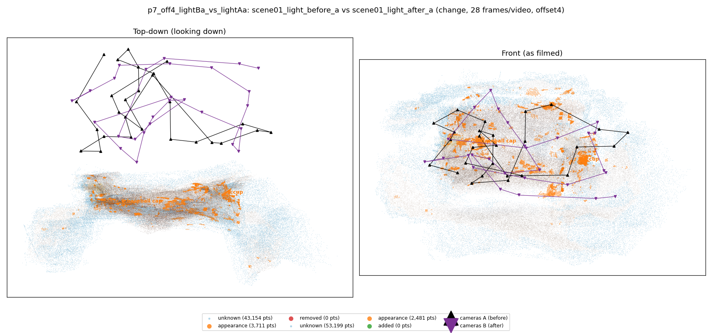
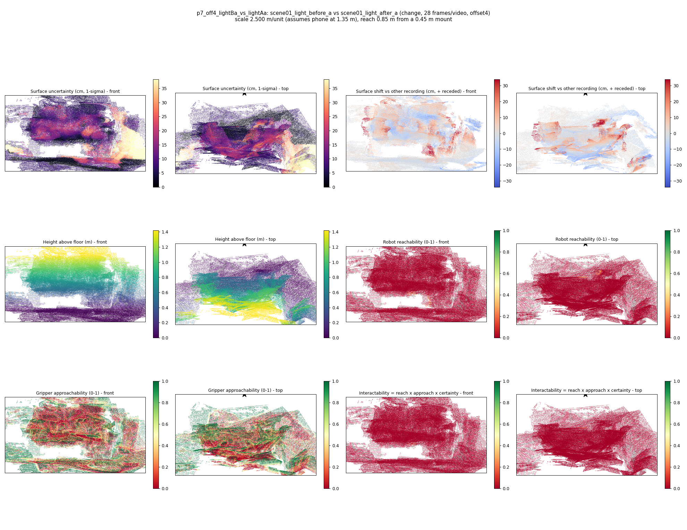

# p7_off4_lightBa_vs_lightAa

**scene01_light_before_a** (A, before) vs **scene01_light_after_a** (B, after) - pair type **change**, 28 frames per video, variant `offset4`.

Distances are in cm, from a floor fit and an assumed phone height (scale 2.5001 m/unit, range [2.0371, 2.9631]).

| Measure | Value |
|---|---|
| Observed share (A / B) | 85.5% / 82.1% |
| Changed share of observed points (A / B) | 1.46% / 1.02% |
| Alignment residual across / within recordings | 0.0327 / 0.0331 |
| Thresholds (depth tau, see-through fraction, appearance) | 0.09892 / 1.0 / 0.89209 |
| Changes (moved / removed / added / appearance) | 0 / 0 / 0 / 2 |
| Reconstruction time | 27.4 s (GPU peak 9.57 GB) |

Heat maps (recording B): reachable 0%, approachable 30%, interactable 0%; surface uncertainty median 6.854 cm (90th pct 25.676); surface shift 99th pct 33.872 cm.

## Changes

- **0 appearance** baseball cap (p=0.247, 820 pts, centroid +/- 0.029): The baseball cap looks different (turned over, deformed or swapped) but occupies the same place.
- **1 appearance** cup (p=0.3, 746 pts, centroid +/- 0.029): The cup looks different (turned over, deformed or swapped) but occupies the same place.
