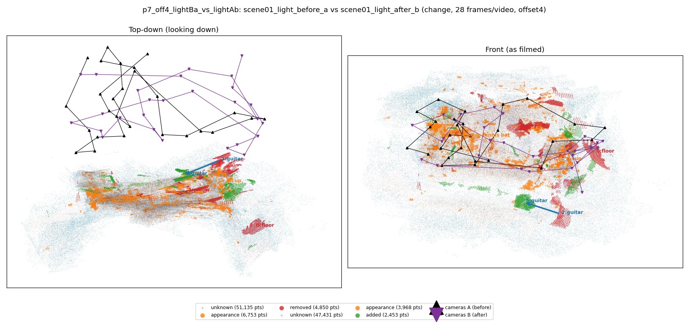
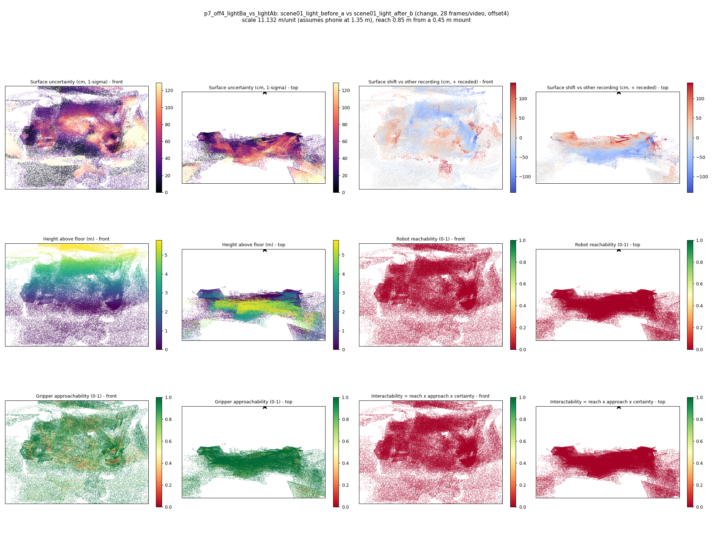

# p7_off4_lightBa_vs_lightAb

**scene01_light_before_a** (A, before) vs **scene01_light_after_b** (B, after) - pair type **change**, 28 frames per video, variant `offset4`.

Distances are in cm, from a floor fit and an assumed phone height (scale 11.132 m/unit, range [9.0705, 13.1935]).

| Measure | Value |
|---|---|
| Observed share (A / B) | 82.8% / 84.1% |
| Changed share of observed points (A / B) | 4.71% / 2.57% |
| Alignment residual across / within recordings | 0.0405 / 0.037 |
| Thresholds (depth tau, see-through fraction, appearance) | 0.11136 / 0.85714 / 0.88457 |
| Changes (moved / removed / added / appearance) | 1 / 2 / 0 / 3 |
| Reconstruction time | 27.4 s (GPU peak 9.57 GB) |

Heat maps (recording B): reachable 0%, approachable 73%, interactable 0%; surface uncertainty median 29.968 cm (90th pct 98.682); surface shift 99th pct 140.519 cm.

## Changes

- **4 appearance** table tennis bat (p=0.615, 1903 pts, centroid +/- 0.032): The table tennis bat looks different (turned over, deformed or swapped) but occupies the same place.
- **1 removed** pillow (p=0.565, 1378 pts, centroid +/- 0.032): A pillow that was there in the first recording is no longer there.
- **3 appearance** book (p=0.891, 1168 pts, centroid +/- 0.032): The book looks different (turned over, deformed or swapped) but occupies the same place.
- **5 moved** guitar (p=0.993, 929 pts, centroid +/- 0.032, 90% interval 0.16-0.31): The guitar moved to the left and further from the camera by about 260.81 cm (90% interval 176.50 to 346.00).
- **6 appearance** cup (p=0.743, 838 pts, centroid +/- 0.032): The cup looks different (turned over, deformed or swapped) but occupies the same place.
- **0 removed** floor (p=0.168, 770 pts, centroid +/- 0.032): A floor that was there in the first recording is no longer there.
