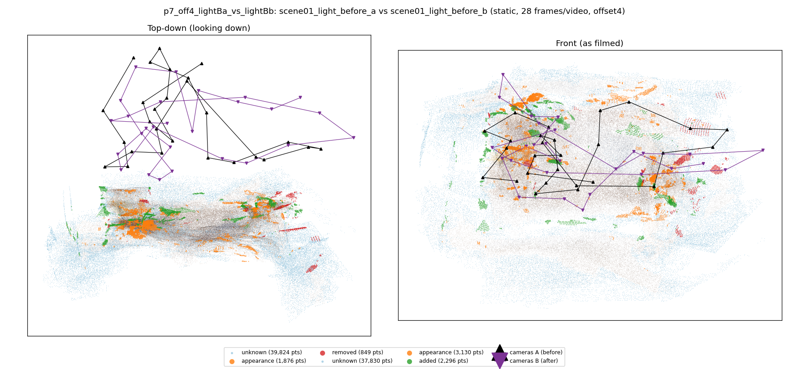
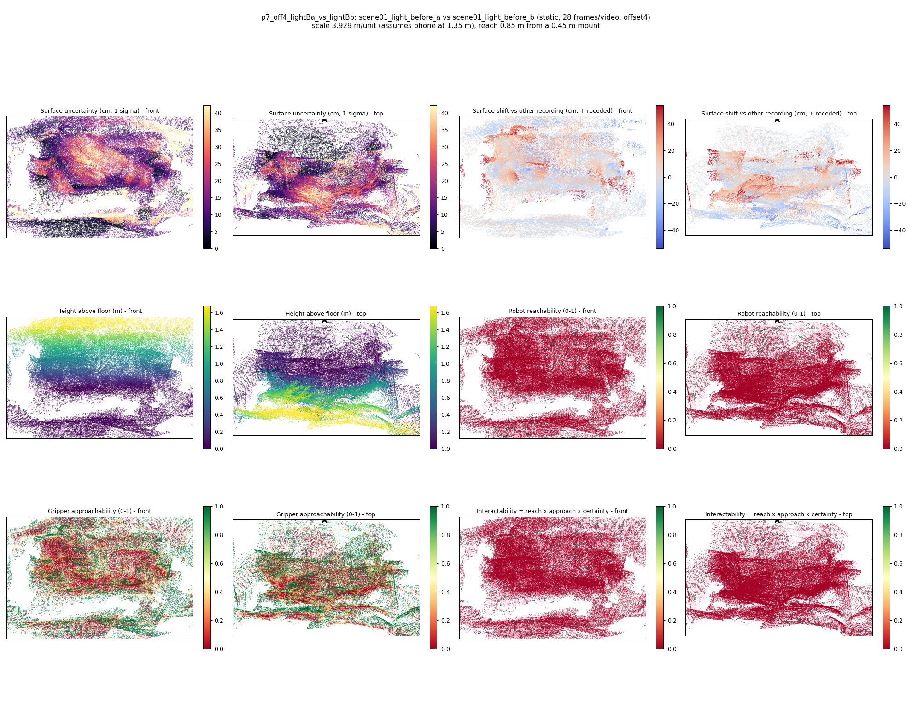

# p7_off4_lightBa_vs_lightBb

**scene01_light_before_a** (A, before) vs **scene01_light_before_b** (B, after) - pair type **static**, 28 frames per video, variant `offset4`.

Distances are in cm, from a floor fit and an assumed phone height (scale 3.9293 m/unit, range [3.2016, 4.6569]).

| Measure | Value |
|---|---|
| Observed share (A / B) | 86.6% / 87.3% |
| Changed share of observed points (A / B) | 1.06% / 2.09% |
| Alignment residual across / within recordings | 0.0355 / 0.0359 |
| Thresholds (depth tau, see-through fraction, appearance) | 0.1073 / 0.905 / 0.89505 |
| Changes (moved / removed / added / appearance) | 0 / 0 / 0 / 1 |
| Reconstruction time | 27.3 s (GPU peak 9.57 GB) |

Nothing was moved between these recordings, so every flagged point is a false change: **false-change rate 1.57%**.

Heat maps (recording B): reachable 0%, approachable 36%, interactable 0%; surface uncertainty median 11.444 cm (90th pct 33.176); surface shift 99th pct 53.734 cm.

## Changes

- **0 appearance** box (p=0.276, 625 pts, centroid +/- 0.031): The box looks different (turned over, deformed or swapped) but occupies the same place.
