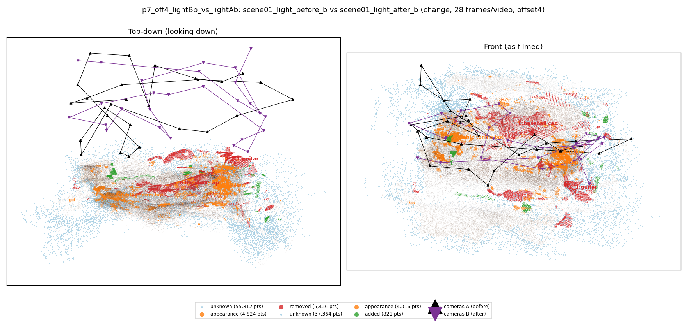
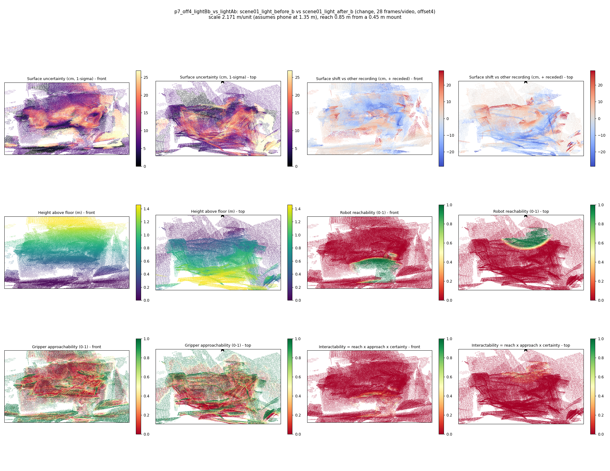

# p7_off4_lightBb_vs_lightAb

**scene01_light_before_b** (A, before) vs **scene01_light_after_b** (B, after) - pair type **change**, 28 frames per video, variant `offset4`.

Distances are in cm, from a floor fit and an assumed phone height (scale 2.1709 m/unit, range [1.7689, 2.573]).

| Measure | Value |
|---|---|
| Observed share (A / B) | 81.2% / 87.4% |
| Changed share of observed points (A / B) | 4.25% / 1.98% |
| Alignment residual across / within recordings | 0.0512 / 0.0492 |
| Thresholds (depth tau, see-through fraction, appearance) | 0.14735 / 0.8 / 0.90267 |
| Changes (moved / removed / added / appearance) | 0 / 2 / 0 / 3 |
| Reconstruction time | 27.3 s (GPU peak 9.57 GB) |

Heat maps (recording B): reachable 7%, approachable 34%, interactable 0%; surface uncertainty median 7.389 cm (90th pct 22.043); surface shift 99th pct 28.655 cm.

## Changes

- **2 appearance** table tennis bat (p=0.996, 2353 pts, centroid +/- 0.047): The table tennis bat looks different (turned over, deformed or swapped) but occupies the same place.
- **3 appearance** pillow (p=0.199, 2057 pts, centroid +/- 0.047): The pillow looks different (turned over, deformed or swapped) but occupies the same place.
- **0 removed** baseball cap (p=0.176, 1941 pts, centroid +/- 0.047): A baseball cap that was there in the first recording is no longer there.
- **4 appearance** cup (p=0.495, 916 pts, centroid +/- 0.047): The cup looks different (turned over, deformed or swapped) but occupies the same place.
- **1 removed** guitar (p=0.844, 764 pts, centroid +/- 0.047): A guitar that was there in the first recording is no longer there.
