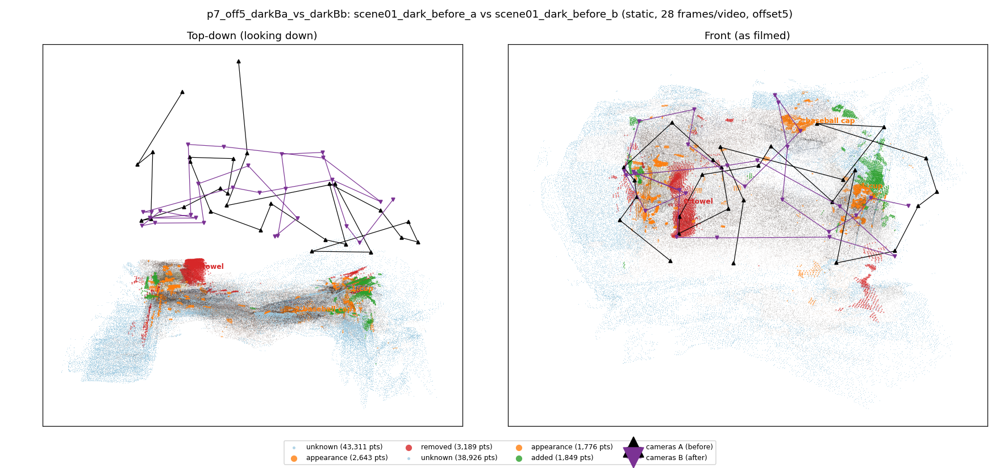
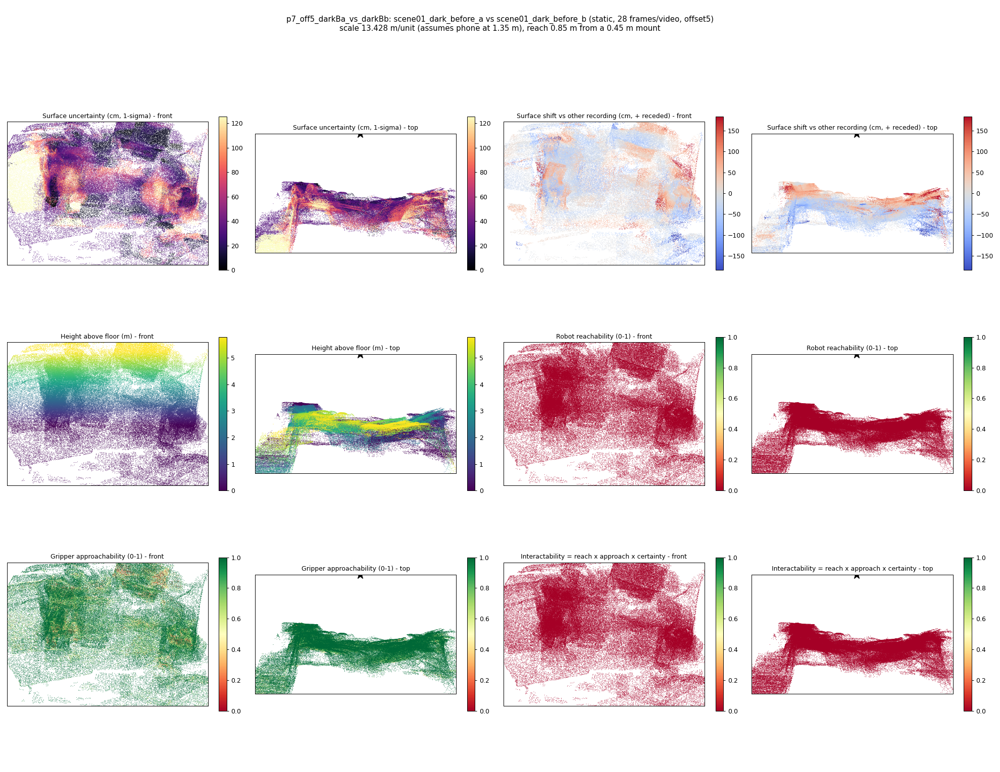

# p7_off5_darkBa_vs_darkBb

**scene01_dark_before_a** (A, before) vs **scene01_dark_before_b** (B, after) - pair type **static**, 28 frames per video, variant `offset5`.

Distances are in cm, from a floor fit and an assumed phone height (scale 13.4275 m/unit, range [10.9409, 15.9141]).

| Measure | Value |
|---|---|
| Observed share (A / B) | 85.7% / 87.6% |
| Changed share of observed points (A / B) | 2.24% / 1.31% |
| Alignment residual across / within recordings | 0.0538 / 0.0576 |
| Thresholds (depth tau, see-through fraction, appearance) | 0.17248 / 0.75 / 0.9157 |
| Changes (moved / removed / added / appearance) | 0 / 1 / 0 / 2 |
| Reconstruction time | 27.6 s (GPU peak 9.57 GB) |

Nothing was moved between these recordings, so every flagged point is a false change: **false-change rate 1.78%**.

Heat maps (recording B): reachable 0%, approachable 80%, interactable 0%; surface uncertainty median 32.883 cm (90th pct 92.46); surface shift 99th pct 184.23 cm.

## Changes

- **0 removed** towel (p=0.156, 2312 pts, centroid +/- 0.041): A towel that was there in the first recording is no longer there.
- **1 appearance** cup (p=0.727, 630 pts, centroid +/- 0.041): The cup looks different (turned over, deformed or swapped) but occupies the same place.
- **2 appearance** baseball cap (p=0.626, 626 pts, centroid +/- 0.041): The baseball cap looks different (turned over, deformed or swapped) but occupies the same place.
