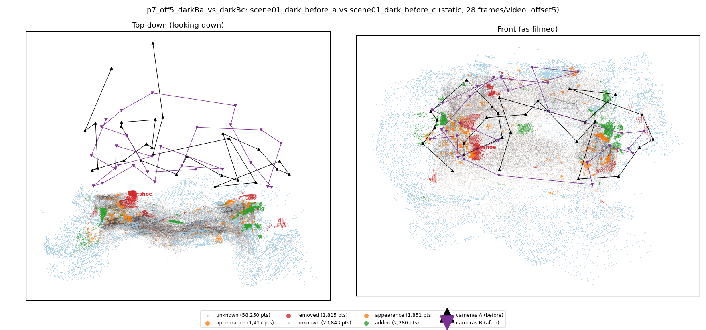
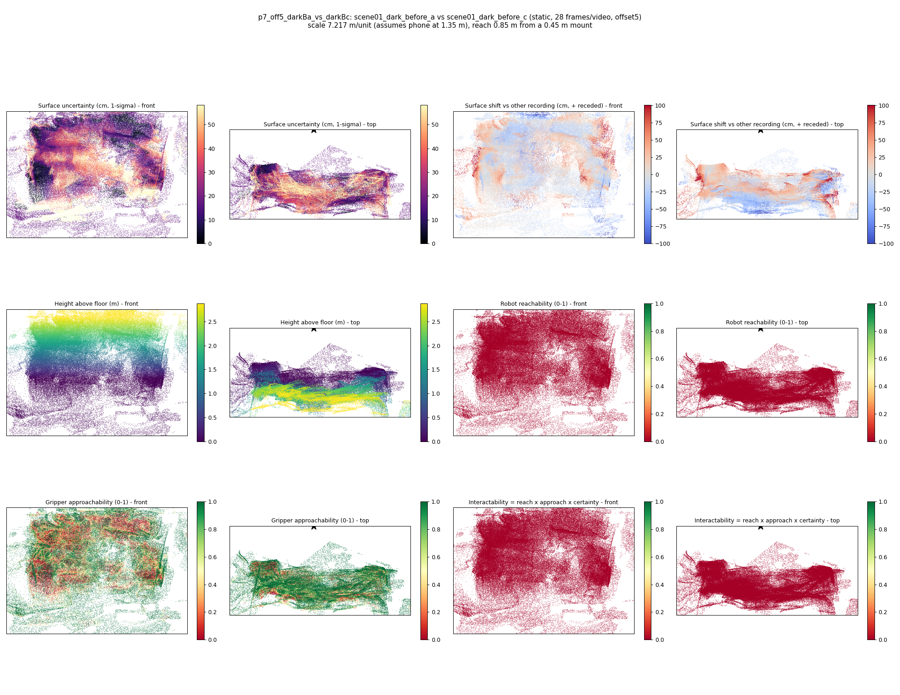

# p7_off5_darkBa_vs_darkBc

**scene01_dark_before_a** (A, before) vs **scene01_dark_before_c** (B, after) - pair type **static**, 28 frames per video, variant `offset5`.

Distances are in cm, from a floor fit and an assumed phone height (scale 7.2169 m/unit, range [5.8805, 8.5534]).

| Measure | Value |
|---|---|
| Observed share (A / B) | 81.5% / 92.1% |
| Changed share of observed points (A / B) | 1.26% / 1.48% |
| Alignment residual across / within recordings | 0.0612 / 0.0612 |
| Thresholds (depth tau, see-through fraction, appearance) | 0.18394 / 0.66667 / 0.92841 |
| Changes (moved / removed / added / appearance) | 0 / 1 / 1 / 0 |
| Reconstruction time | 27.3 s (GPU peak 9.57 GB) |

Nothing was moved between these recordings, so every flagged point is a false change: **false-change rate 1.37%**.

Heat maps (recording B): reachable 0%, approachable 47%, interactable 0%; surface uncertainty median 17.869 cm (90th pct 47.248); surface shift 99th pct 100.171 cm.

## Changes

- **0 removed** shoe (p=0.197, 685 pts, centroid +/- 0.041): A shoe that was there in the first recording is no longer there.
- **1 added** rug (p=0.176, 646 pts, centroid +/- 0.041): A rug appears in the second recording that was not there before.
