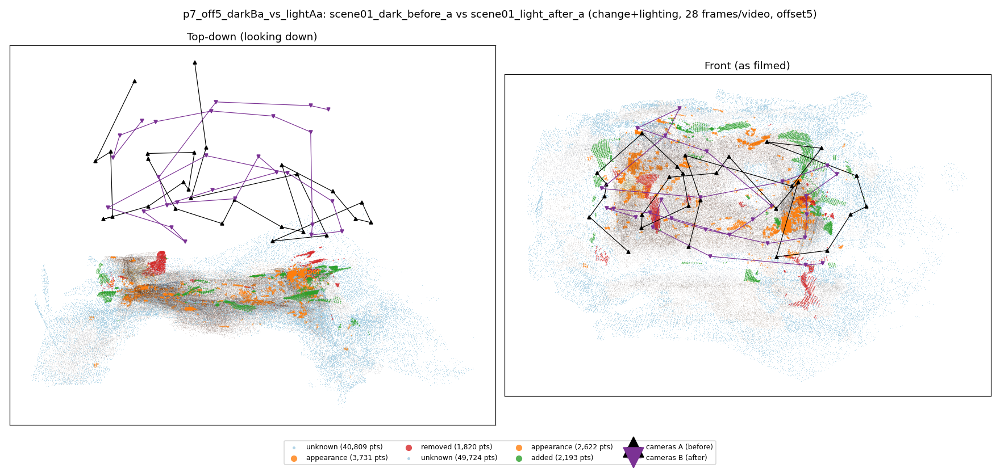
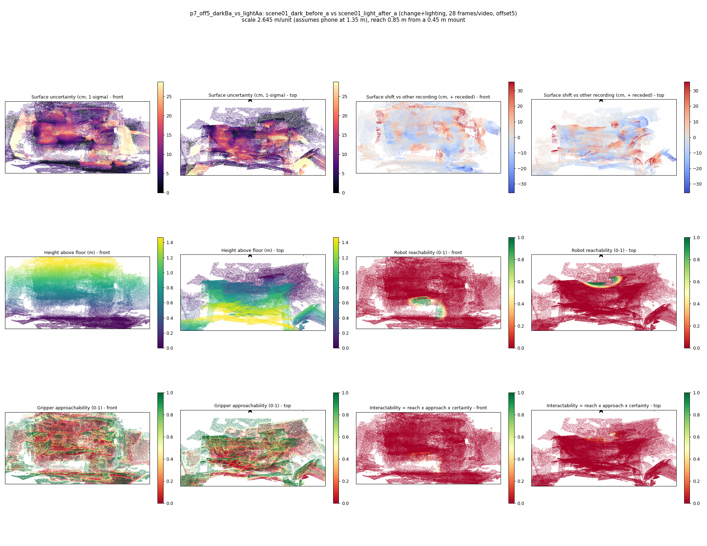

# p7_off5_darkBa_vs_lightAa

**scene01_dark_before_a** (A, before) vs **scene01_light_after_a** (B, after) - pair type **change+lighting**, 28 frames per video, variant `offset5`.

Distances are in cm, from a floor fit and an assumed phone height (scale 2.6455 m/unit, range [2.1556, 3.1354]).

| Measure | Value |
|---|---|
| Observed share (A / B) | 86.3% / 83.3% |
| Changed share of observed points (A / B) | 2.16% / 1.94% |
| Alignment residual across / within recordings | 0.0454 / 0.0461 |
| Thresholds (depth tau, see-through fraction, appearance) | 0.13816 / 0.8 / 0.91019 |
| Changes (moved / removed / added / appearance) | 0 / 0 / 0 / 1 |
| Reconstruction time | 27.4 s (GPU peak 9.57 GB) |

Heat maps (recording B): reachable 2%, approachable 31%, interactable 0%; surface uncertainty median 5.932 cm (90th pct 20.914); surface shift 99th pct 35.561 cm.

## Changes

- **0 appearance** floor (p=0.212, 940 pts, centroid +/- 0.033): The floor looks different (turned over, deformed or swapped) but occupies the same place.
