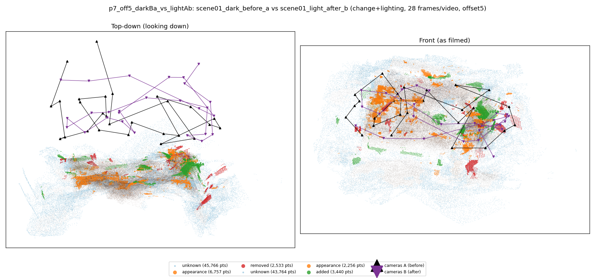
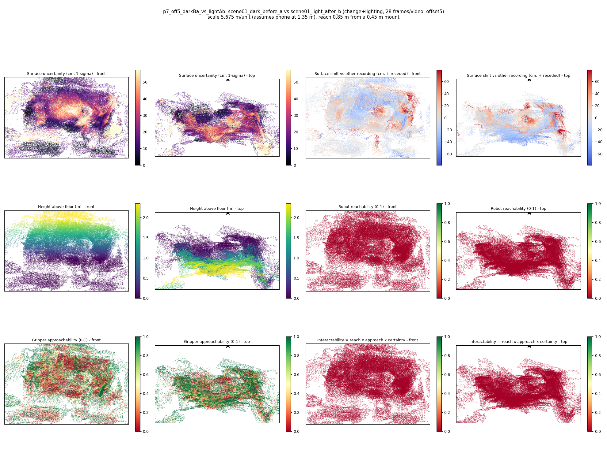

# p7_off5_darkBa_vs_lightAb

**scene01_dark_before_a** (A, before) vs **scene01_light_after_b** (B, after) - pair type **change+lighting**, 28 frames per video, variant `offset5`.

Distances are in cm, from a floor fit and an assumed phone height (scale 5.6752 m/unit, range [4.6242, 6.7261]).

| Measure | Value |
|---|---|
| Observed share (A / B) | 84.6% / 85.3% |
| Changed share of observed points (A / B) | 3.69% / 2.24% |
| Alignment residual across / within recordings | 0.0524 / 0.0523 |
| Thresholds (depth tau, see-through fraction, appearance) | 0.15729 / 0.71429 / 0.91471 |
| Changes (moved / removed / added / appearance) | 0 / 0 / 1 / 2 |
| Reconstruction time | 27.4 s (GPU peak 9.57 GB) |

Heat maps (recording B): reachable 0%, approachable 39%, interactable 0%; surface uncertainty median 15.615 cm (90th pct 44.733); surface shift 99th pct 78.735 cm.

## Changes

- **0 appearance** table tennis bat (p=0.999, 3190 pts, centroid +/- 0.038): The table tennis bat looks different (turned over, deformed or swapped) but occupies the same place.
- **2 added** sofa (p=0.464, 1501 pts, centroid +/- 0.038): A sofa appears in the second recording that was not there before.
- **1 appearance** cup (p=0.649, 615 pts, centroid +/- 0.038): The cup looks different (turned over, deformed or swapped) but occupies the same place.
