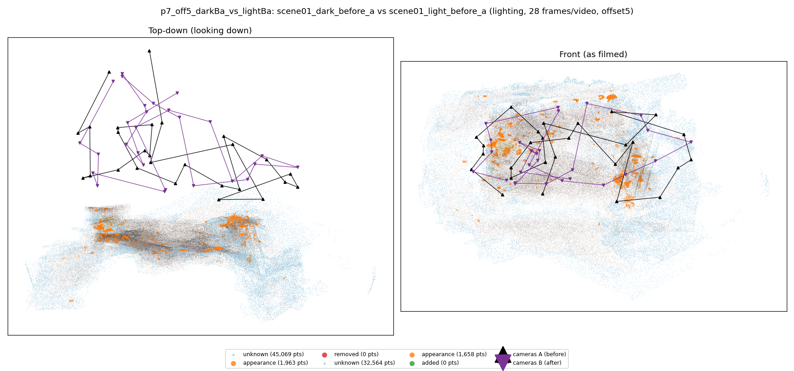
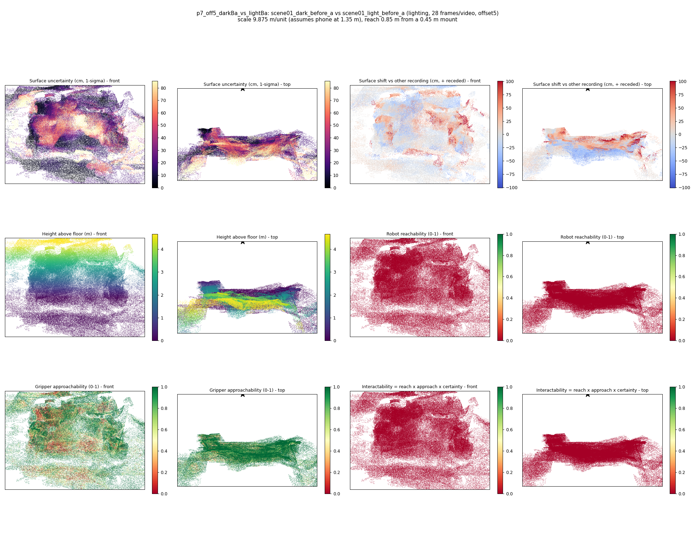

# p7_off5_darkBa_vs_lightBa

**scene01_dark_before_a** (A, before) vs **scene01_light_before_a** (B, after) - pair type **lighting**, 28 frames per video, variant `offset5`.

Distances are in cm, from a floor fit and an assumed phone height (scale 9.8748 m/unit, range [8.0461, 11.7034]).

| Measure | Value |
|---|---|
| Observed share (A / B) | 84.9% / 89.1% |
| Changed share of observed points (A / B) | 0.78% / 0.62% |
| Alignment residual across / within recordings | 0.0412 / 0.0401 |
| Thresholds (depth tau, see-through fraction, appearance) | 0.11984 / 1.0 / 0.91138 |
| Changes (moved / removed / added / appearance) | 0 / 0 / 0 / 0 |
| Reconstruction time | 27.6 s (GPU peak 9.57 GB) |

Nothing was moved between these recordings, so every flagged point is a false change: **false-change rate 0.70%**.

Heat maps (recording B): reachable 0%, approachable 60%, interactable 0%; surface uncertainty median 19.332 cm (90th pct 67.635); surface shift 99th pct 100.752 cm.

## Changes

- none detected
