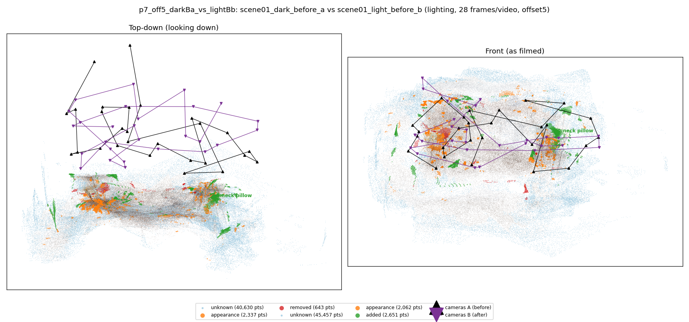
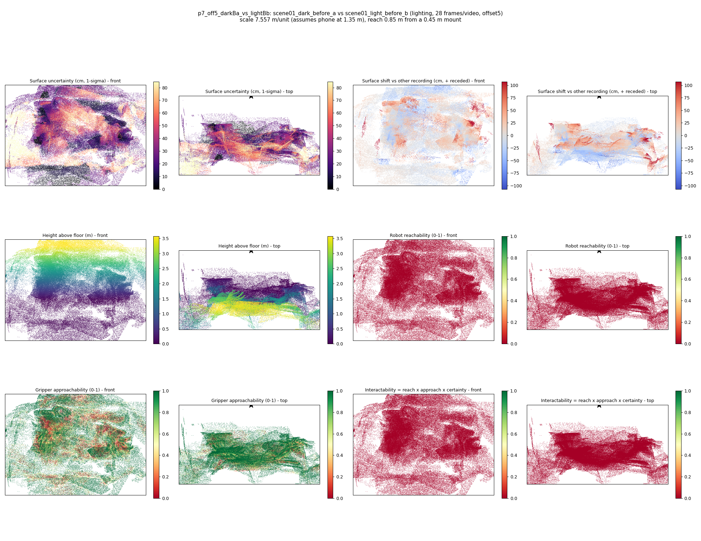

# p7_off5_darkBa_vs_lightBb

**scene01_dark_before_a** (A, before) vs **scene01_light_before_b** (B, after) - pair type **lighting**, 28 frames per video, variant `offset5`.

Distances are in cm, from a floor fit and an assumed phone height (scale 7.5574 m/unit, range [6.1579, 8.9569]).

| Measure | Value |
|---|---|
| Observed share (A / B) | 86.4% / 84.7% |
| Changed share of observed points (A / B) | 1.16% / 1.87% |
| Alignment residual across / within recordings | 0.0527 / 0.053 |
| Thresholds (depth tau, see-through fraction, appearance) | 0.15931 / 0.8 / 0.9202 |
| Changes (moved / removed / added / appearance) | 0 / 0 / 1 / 0 |
| Reconstruction time | 27.4 s (GPU peak 9.57 GB) |

Nothing was moved between these recordings, so every flagged point is a false change: **false-change rate 1.51%**.

Heat maps (recording B): reachable 0%, approachable 57%, interactable 0%; surface uncertainty median 25.308 cm (90th pct 68.233); surface shift 99th pct 107.282 cm.

## Changes

- **0 added** neck pillow (p=0.206, 909 pts, centroid +/- 0.039): A neck pillow appears in the second recording that was not there before.
