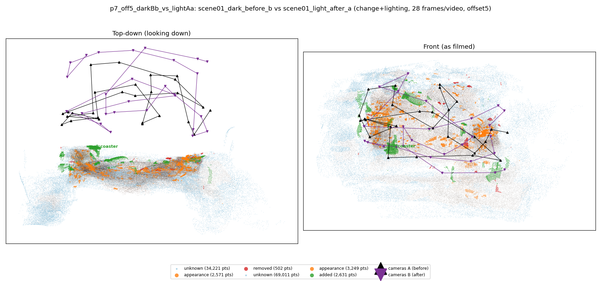
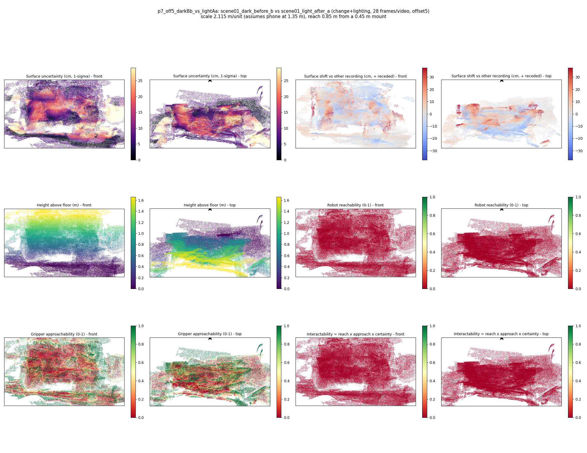

# p7_off5_darkBb_vs_lightAa

**scene01_dark_before_b** (A, before) vs **scene01_light_after_a** (B, after) - pair type **change+lighting**, 28 frames per video, variant `offset5`.

Distances are in cm, from a floor fit and an assumed phone height (scale 2.1147 m/unit, range [1.7231, 2.5063]).

| Measure | Value |
|---|---|
| Observed share (A / B) | 88.5% / 76.8% |
| Changed share of observed points (A / B) | 1.17% / 2.58% |
| Alignment residual across / within recordings | 0.0419 / 0.0428 |
| Thresholds (depth tau, see-through fraction, appearance) | 0.1288 / 0.85714 / 0.9043 |
| Changes (moved / removed / added / appearance) | 0 / 0 / 1 / 1 |
| Reconstruction time | 27.3 s (GPU peak 9.57 GB) |

Heat maps (recording B): reachable 0%, approachable 31%, interactable 0%; surface uncertainty median 7.239 cm (90th pct 22.577); surface shift 99th pct 37.411 cm.

## Changes

- **1 appearance** cup (p=0.637, 984 pts, centroid +/- 0.044): The cup looks different (turned over, deformed or swapped) but occupies the same place.
- **0 added** coaster (p=0.257, 751 pts, centroid +/- 0.044): A coaster appears in the second recording that was not there before.
