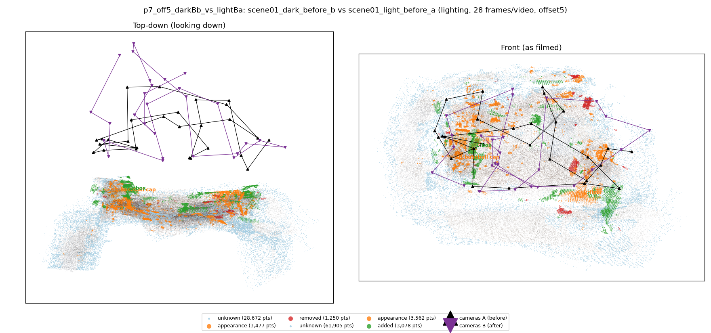
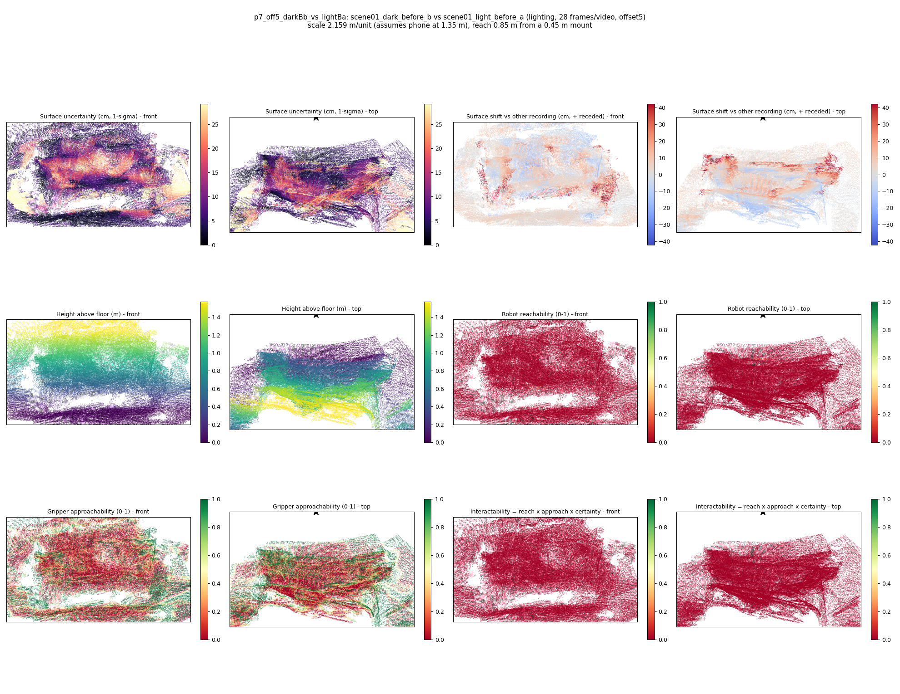

# p7_off5_darkBb_vs_lightBa

**scene01_dark_before_b** (A, before) vs **scene01_light_before_a** (B, after) - pair type **lighting**, 28 frames per video, variant `offset5`.

Distances are in cm, from a floor fit and an assumed phone height (scale 2.1595 m/unit, range [1.7596, 2.5594]).

| Measure | Value |
|---|---|
| Observed share (A / B) | 90.4% / 79.1% |
| Changed share of observed points (A / B) | 1.76% / 2.83% |
| Alignment residual across / within recordings | 0.0385 / 0.038 |
| Thresholds (depth tau, see-through fraction, appearance) | 0.11428 / 0.8 / 0.88916 |
| Changes (moved / removed / added / appearance) | 0 / 0 / 1 / 2 |
| Reconstruction time | 27.2 s (GPU peak 9.57 GB) |

Nothing was moved between these recordings, so every flagged point is a false change: **false-change rate 2.29%**.

Heat maps (recording B): reachable 0%, approachable 26%, interactable 0%; surface uncertainty median 5.909 cm (90th pct 23.297); surface shift 99th pct 41.925 cm.

## Changes

- **1 added** box (p=0.436, 720 pts, centroid +/- 0.038): A box appears in the second recording that was not there before.
- **0 appearance** baseball cap (p=0.075, 632 pts, centroid +/- 0.038): The baseball cap looks different (turned over, deformed or swapped) but occupies the same place.
- **2 appearance** floor (p=0.237, 614 pts, centroid +/- 0.038): The floor looks different (turned over, deformed or swapped) but occupies the same place.
