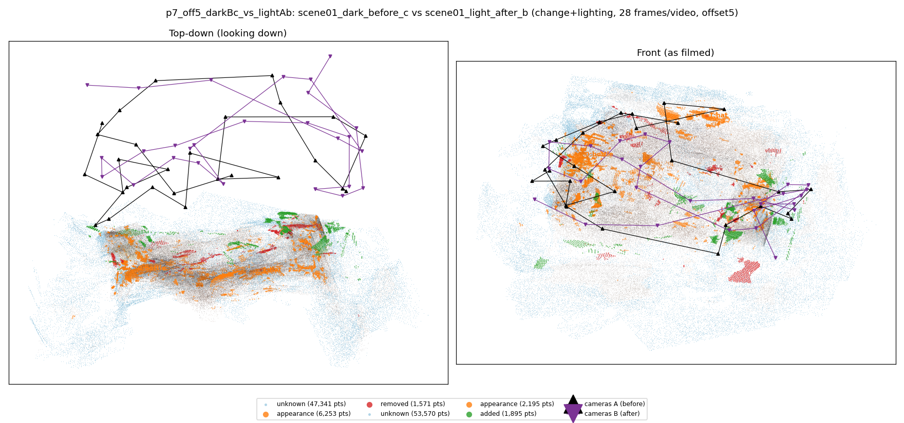
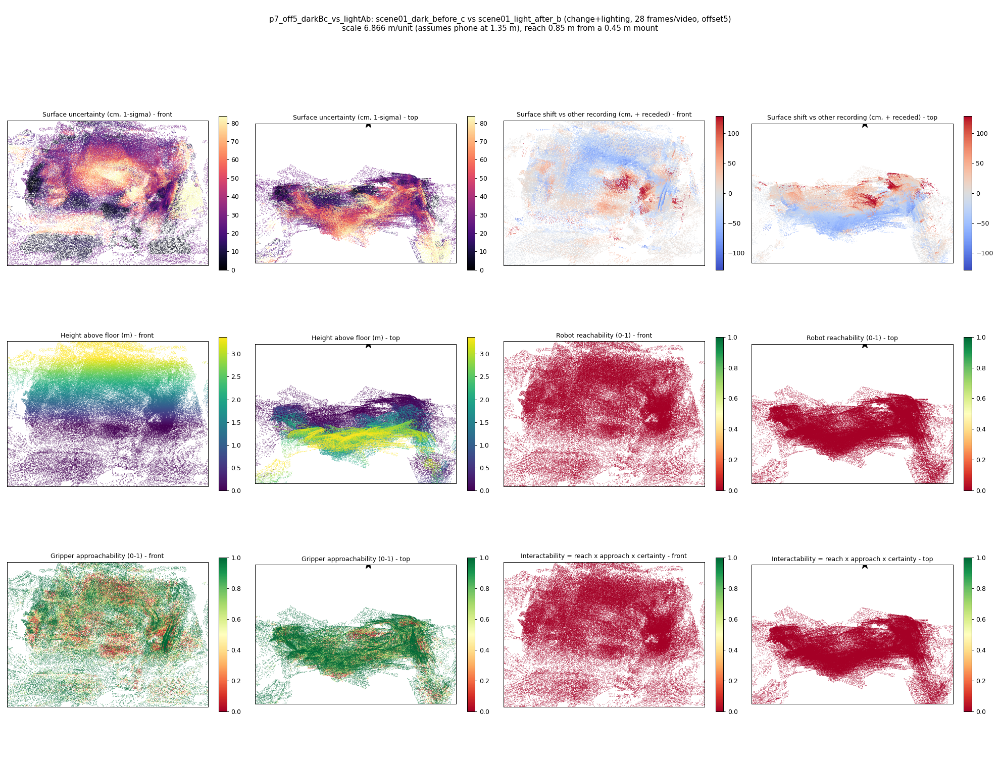

# p7_off5_darkBc_vs_lightAb

**scene01_dark_before_c** (A, before) vs **scene01_light_after_b** (B, after) - pair type **change+lighting**, 28 frames per video, variant `offset5`.

Distances are in cm, from a floor fit and an assumed phone height (scale 6.8659 m/unit, range [5.5944, 8.1373]).

| Measure | Value |
|---|---|
| Observed share (A / B) | 84.1% / 82.0% |
| Changed share of observed points (A / B) | 3.13% / 1.68% |
| Alignment residual across / within recordings | 0.0549 / 0.0539 |
| Thresholds (depth tau, see-through fraction, appearance) | 0.16136 / 0.66667 / 0.90938 |
| Changes (moved / removed / added / appearance) | 0 / 0 / 0 / 2 |
| Reconstruction time | 27.3 s (GPU peak 9.57 GB) |

Heat maps (recording B): reachable 0%, approachable 57%, interactable 0%; surface uncertainty median 26.921 cm (90th pct 68.554); surface shift 99th pct 128.31 cm.

## Changes

- **0 appearance** bottle (p=0.287, 2012 pts, centroid +/- 0.049): The bottle looks different (turned over, deformed or swapped) but occupies the same place.
- **1 appearance** hat (p=0.469, 645 pts, centroid +/- 0.049): The hat looks different (turned over, deformed or swapped) but occupies the same place.
