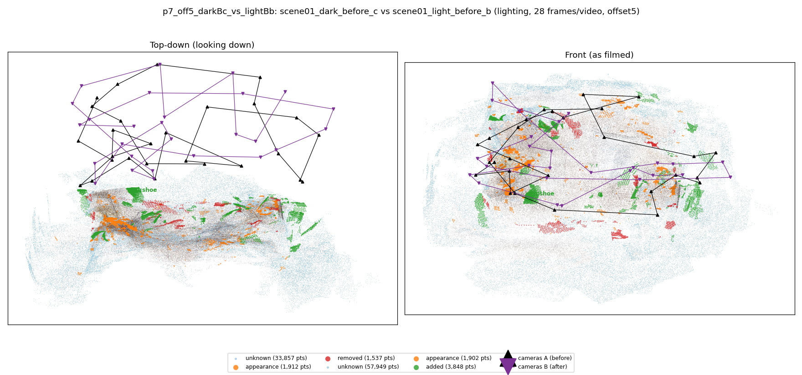
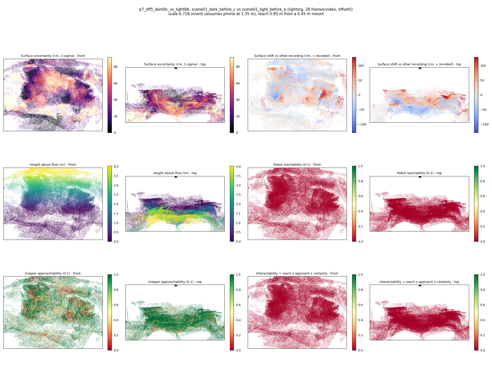

# p7_off5_darkBc_vs_lightBb

**scene01_dark_before_c** (A, before) vs **scene01_light_before_b** (B, after) - pair type **lighting**, 28 frames per video, variant `offset5`.

Distances are in cm, from a floor fit and an assumed phone height (scale 6.7278 m/unit, range [5.4819, 7.9737]).

| Measure | Value |
|---|---|
| Observed share (A / B) | 88.6% / 80.5% |
| Changed share of observed points (A / B) | 1.31% / 2.40% |
| Alignment residual across / within recordings | 0.0583 / 0.0558 |
| Thresholds (depth tau, see-through fraction, appearance) | 0.16715 / 0.71429 / 0.92041 |
| Changes (moved / removed / added / appearance) | 0 / 0 / 1 / 0 |
| Reconstruction time | 27.7 s (GPU peak 9.57 GB) |

Nothing was moved between these recordings, so every flagged point is a false change: **false-change rate 1.85%**.

Heat maps (recording B): reachable 0%, approachable 61%, interactable 0%; surface uncertainty median 27.078 cm (90th pct 73.876); surface shift 99th pct 129.287 cm.

## Changes

- **0 added** shoe (p=0.138, 922 pts, centroid +/- 0.051): A shoe appears in the second recording that was not there before.
