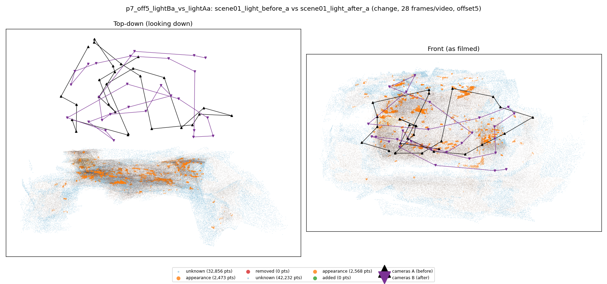
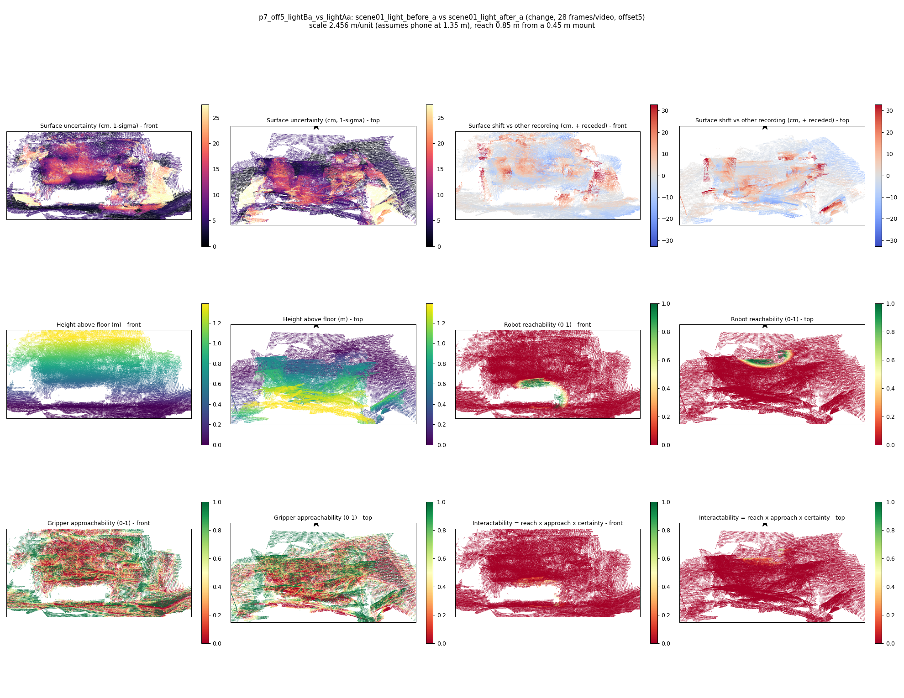

# p7_off5_lightBa_vs_lightAa

**scene01_light_before_a** (A, before) vs **scene01_light_after_a** (B, after) - pair type **change**, 28 frames per video, variant `offset5`.

Distances are in cm, from a floor fit and an assumed phone height (scale 2.456 m/unit, range [2.0012, 2.9108]).

| Measure | Value |
|---|---|
| Observed share (A / B) | 88.9% / 85.8% |
| Changed share of observed points (A / B) | 0.94% / 1.01% |
| Alignment residual across / within recordings | 0.0299 / 0.0294 |
| Thresholds (depth tau, see-through fraction, appearance) | 0.08802 / 1.0 / 0.88794 |
| Changes (moved / removed / added / appearance) | 0 / 0 / 0 / 0 |
| Reconstruction time | 27.5 s (GPU peak 9.57 GB) |

Heat maps (recording B): reachable 2%, approachable 33%, interactable 0%; surface uncertainty median 5.202 cm (90th pct 20.217); surface shift 99th pct 32.672 cm.

## Changes

- none detected
