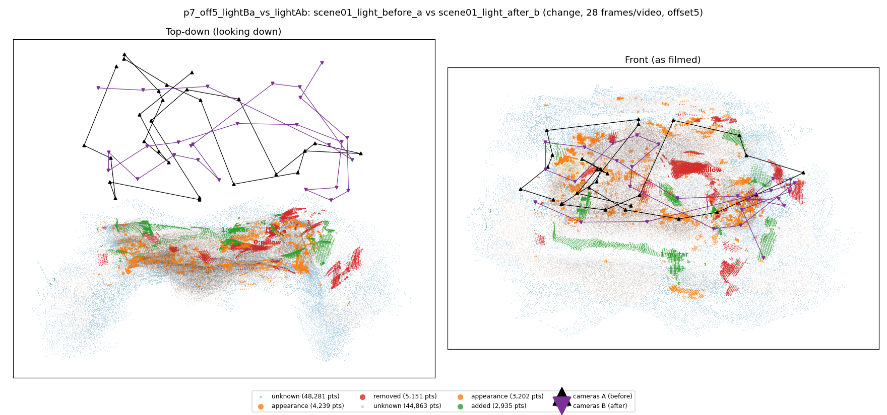
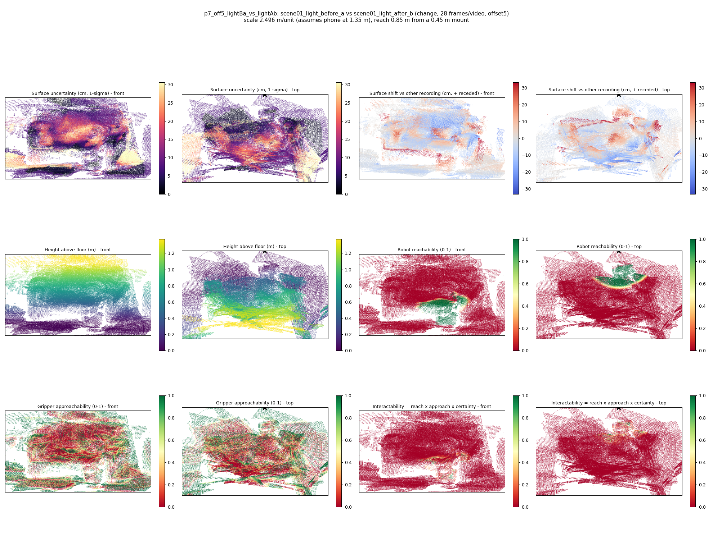

# p7_off5_lightBa_vs_lightAb

**scene01_light_before_a** (A, before) vs **scene01_light_after_b** (B, after) - pair type **change**, 28 frames per video, variant `offset5`.

Distances are in cm, from a floor fit and an assumed phone height (scale 2.4956 m/unit, range [2.0334, 2.9577]).

| Measure | Value |
|---|---|
| Observed share (A / B) | 83.8% / 84.9% |
| Changed share of observed points (A / B) | 3.77% / 2.43% |
| Alignment residual across / within recordings | 0.0415 / 0.0367 |
| Thresholds (depth tau, see-through fraction, appearance) | 0.10958 / 0.8 / 0.88818 |
| Changes (moved / removed / added / appearance) | 0 / 1 / 1 / 0 |
| Reconstruction time | 27.4 s (GPU peak 9.57 GB) |

Heat maps (recording B): reachable 5%, approachable 30%, interactable 0%; surface uncertainty median 7.145 cm (90th pct 24.497); surface shift 99th pct 33.015 cm.

## Changes

- **0 removed** pillow (p=0.3, 2057 pts, centroid +/- 0.031): A pillow that was there in the first recording is no longer there.
- **1 added** guitar (p=0.992, 626 pts, centroid +/- 0.031): A guitar appears in the second recording that was not there before.
