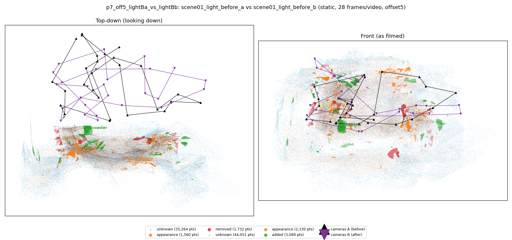
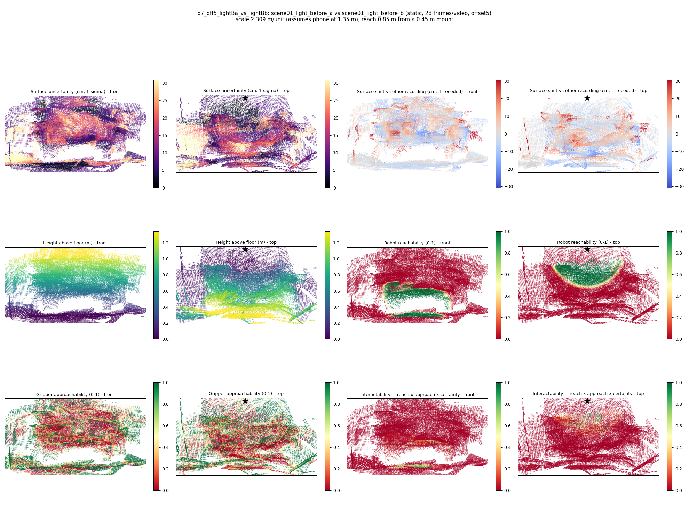

# p7_off5_lightBa_vs_lightBb

**scene01_light_before_a** (A, before) vs **scene01_light_before_b** (B, after) - pair type **static**, 28 frames per video, variant `offset5`.

Distances are in cm, from a floor fit and an assumed phone height (scale 2.3088 m/unit, range [1.8812, 2.7363]).

| Measure | Value |
|---|---|
| Observed share (A / B) | 88.1% / 85.2% |
| Changed share of observed points (A / B) | 1.26% / 2.14% |
| Alignment residual across / within recordings | 0.0411 / 0.0384 |
| Thresholds (depth tau, see-through fraction, appearance) | 0.11486 / 0.83333 / 0.9043 |
| Changes (moved / removed / added / appearance) | 0 / 0 / 1 / 0 |
| Reconstruction time | 27.3 s (GPU peak 9.57 GB) |

Nothing was moved between these recordings, so every flagged point is a false change: **false-change rate 1.70%**.

Heat maps (recording B): reachable 14%, approachable 34%, interactable 1%; surface uncertainty median 8.395 cm (90th pct 25.366); surface shift 99th pct 30.631 cm.

## Changes

- **0 added** coaster (p=0.116, 1140 pts, centroid +/- 0.032): A coaster appears in the second recording that was not there before.
