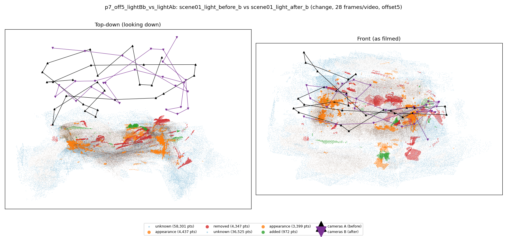
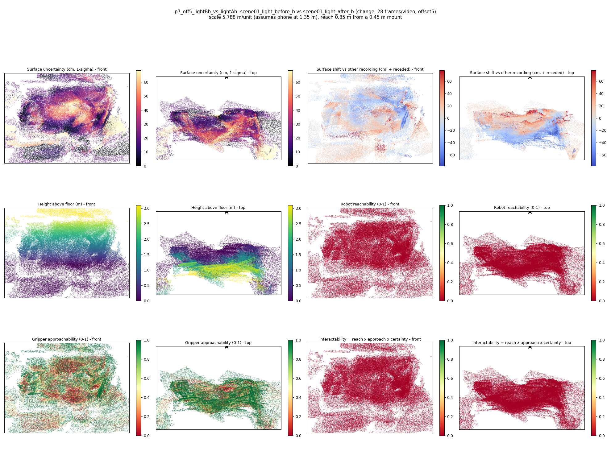

# p7_off5_lightBb_vs_lightAb

**scene01_light_before_b** (A, before) vs **scene01_light_after_b** (B, after) - pair type **change**, 28 frames per video, variant `offset5`.

Distances are in cm, from a floor fit and an assumed phone height (scale 5.7885 m/unit, range [4.7165, 6.8604]).

| Measure | Value |
|---|---|
| Observed share (A / B) | 80.4% / 87.7% |
| Changed share of observed points (A / B) | 3.67% / 1.68% |
| Alignment residual across / within recordings | 0.0566 / 0.0547 |
| Thresholds (depth tau, see-through fraction, appearance) | 0.16332 / 0.75 / 0.91985 |
| Changes (moved / removed / added / appearance) | 0 / 1 / 0 / 3 |
| Reconstruction time | 27.3 s (GPU peak 9.57 GB) |

Heat maps (recording B): reachable 0%, approachable 49%, interactable 0%; surface uncertainty median 20.203 cm (90th pct 54.29); surface shift 99th pct 77.939 cm.

## Changes

- **1 appearance** hat (p=0.212, 1822 pts, centroid +/- 0.053): The hat looks different (turned over, deformed or swapped) but occupies the same place.
- **0 removed** pillow (p=0.416, 1627 pts, centroid +/- 0.053): A pillow that was there in the first recording is no longer there.
- **3 appearance** shoe (p=0.271, 1503 pts, centroid +/- 0.053): The shoe looks different (turned over, deformed or swapped) but occupies the same place.
- **2 appearance** rug (p=0.194, 787 pts, centroid +/- 0.053): The rug looks different (turned over, deformed or swapped) but occupies the same place.
