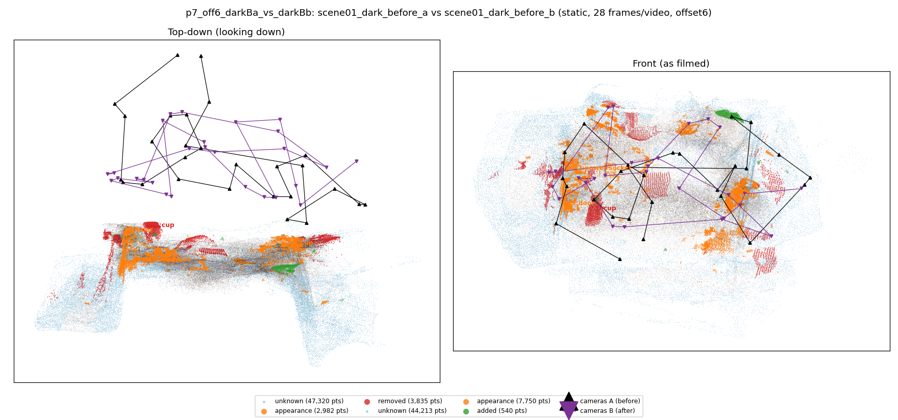
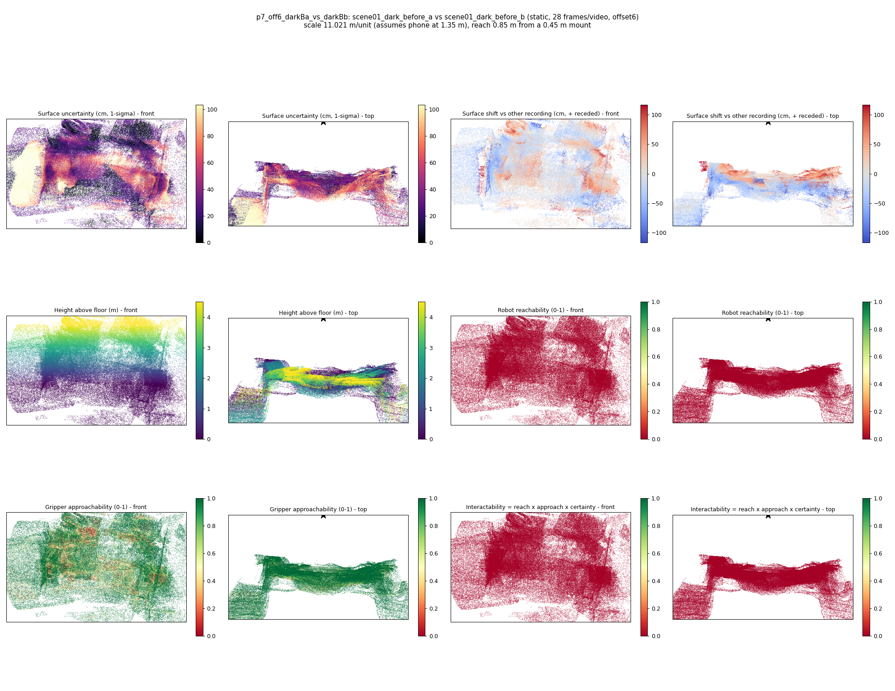

# p7_off6_darkBa_vs_darkBb

**scene01_dark_before_a** (A, before) vs **scene01_dark_before_b** (B, after) - pair type **static**, 28 frames per video, variant `offset6`.

Distances are in cm, from a floor fit and an assumed phone height (scale 11.0213 m/unit, range [8.9803, 13.0623]).

| Measure | Value |
|---|---|
| Observed share (A / B) | 85.0% / 86.2% |
| Changed share of observed points (A / B) | 2.54% / 2.99% |
| Alignment residual across / within recordings | 0.0497 / 0.0491 |
| Thresholds (depth tau, see-through fraction, appearance) | 0.14715 / 0.75 / 0.89872 |
| Changes (moved / removed / added / appearance) | 0 / 1 / 0 / 3 |
| Reconstruction time | 26.6 s (GPU peak 9.57 GB) |

Nothing was moved between these recordings, so every flagged point is a false change: **false-change rate 2.77%**.

Heat maps (recording B): reachable 0%, approachable 70%, interactable 0%; surface uncertainty median 27.014 cm (90th pct 77.431); surface shift 99th pct 116.733 cm.

## Changes

- **1 appearance** cup (p=0.171, 2141 pts, centroid +/- 0.034): The cup looks different (turned over, deformed or swapped) but occupies the same place.
- **0 removed** cup (p=0.161, 873 pts, centroid +/- 0.034): A cup that was there in the first recording is no longer there.
- **2 appearance** power socket (p=0.125, 785 pts, centroid +/- 0.034): The power socket looks different (turned over, deformed or swapped) but occupies the same place.
- **3 appearance** door (p=0.128, 696 pts, centroid +/- 0.034): The door looks different (turned over, deformed or swapped) but occupies the same place.
