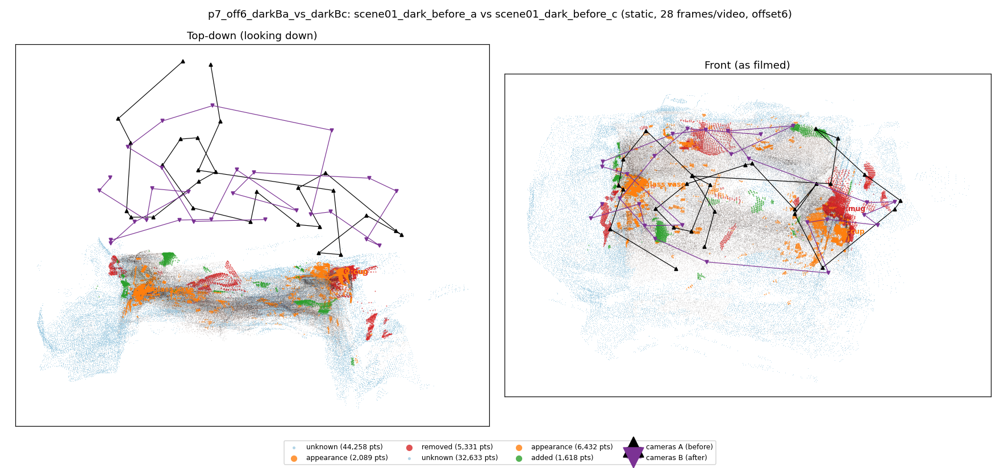
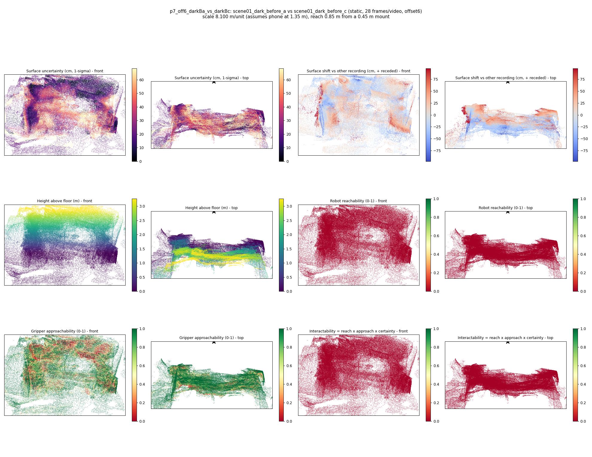

# p7_off6_darkBa_vs_darkBc

**scene01_dark_before_a** (A, before) vs **scene01_dark_before_c** (B, after) - pair type **static**, 28 frames per video, variant `offset6`.

Distances are in cm, from a floor fit and an assumed phone height (scale 8.1 m/unit, range [6.6, 9.6]).

| Measure | Value |
|---|---|
| Observed share (A / B) | 85.4% / 89.4% |
| Changed share of observed points (A / B) | 2.86% / 2.91% |
| Alignment residual across / within recordings | 0.0599 / 0.0569 |
| Thresholds (depth tau, see-through fraction, appearance) | 0.17012 / 0.66667 / 0.9126 |
| Changes (moved / removed / added / appearance) | 0 / 1 / 0 / 2 |
| Reconstruction time | 26.0 s (GPU peak 9.57 GB) |

Nothing was moved between these recordings, so every flagged point is a false change: **false-change rate 2.89%**.

Heat maps (recording B): reachable 0%, approachable 55%, interactable 0%; surface uncertainty median 21.503 cm (90th pct 53.657); surface shift 99th pct 97.227 cm.

## Changes

- **0 removed** mug (p=0.405, 3220 pts, centroid +/- 0.038): A mug that was there in the first recording is no longer there.
- **2 appearance** cup (p=0.489, 2002 pts, centroid +/- 0.038): The cup looks different (turned over, deformed or swapped) but occupies the same place.
- **1 appearance** glass vase (p=0.362, 1978 pts, centroid +/- 0.038): The glass vase looks different (turned over, deformed or swapped) but occupies the same place.
