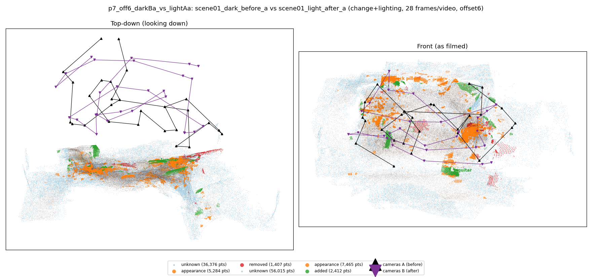
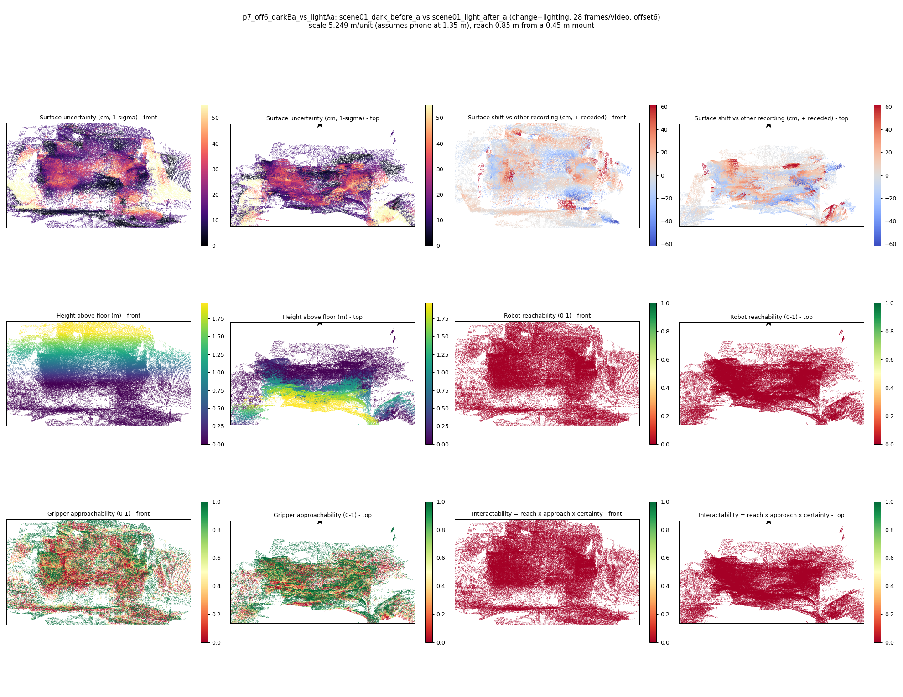

# p7_off6_darkBa_vs_lightAa

**scene01_dark_before_a** (A, before) vs **scene01_light_after_a** (B, after) - pair type **change+lighting**, 28 frames per video, variant `offset6`.

Distances are in cm, from a floor fit and an assumed phone height (scale 5.2494 m/unit, range [4.2773, 6.2215]).

| Measure | Value |
|---|---|
| Observed share (A / B) | 87.8% / 81.2% |
| Changed share of observed points (A / B) | 2.56% / 4.09% |
| Alignment residual across / within recordings | 0.045 / 0.0437 |
| Thresholds (depth tau, see-through fraction, appearance) | 0.13047 / 0.8 / 0.89711 |
| Changes (moved / removed / added / appearance) | 0 / 0 / 1 / 3 |
| Reconstruction time | 26.7 s (GPU peak 9.57 GB) |

Heat maps (recording B): reachable 0%, approachable 38%, interactable 0%; surface uncertainty median 12.328 cm (90th pct 37.296); surface shift 99th pct 61.713 cm.

## Changes

- **2 appearance** cup (p=0.447, 2968 pts, centroid +/- 0.031): The cup looks different (turned over, deformed or swapped) but occupies the same place.
- **3 appearance** neck pillow (p=0.249, 1429 pts, centroid +/- 0.031): The neck pillow looks different (turned over, deformed or swapped) but occupies the same place.
- **0 appearance** floor (p=0.425, 1225 pts, centroid +/- 0.031): The floor looks different (turned over, deformed or swapped) but occupies the same place.
- **1 added** guitar (p=0.992, 703 pts, centroid +/- 0.031): A guitar appears in the second recording that was not there before.
