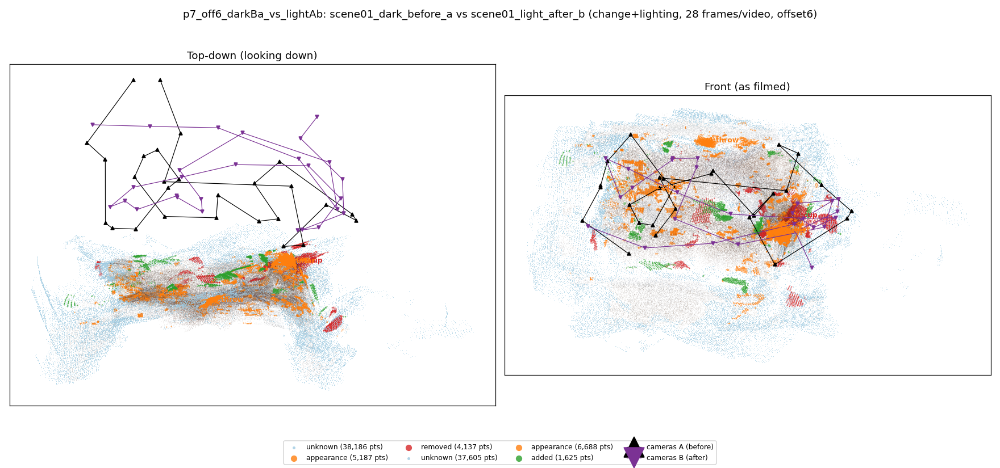
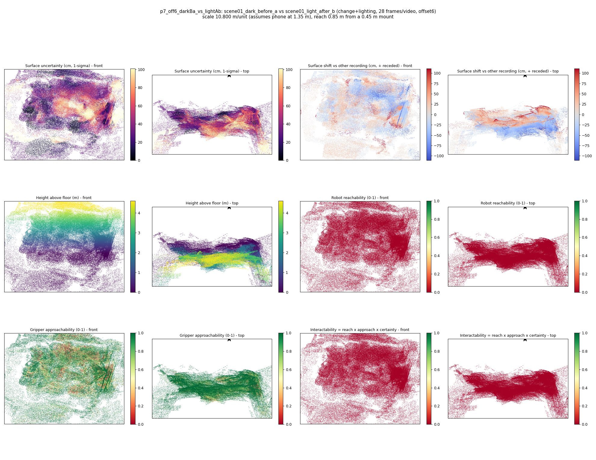

# p7_off6_darkBa_vs_lightAb

**scene01_dark_before_a** (A, before) vs **scene01_light_after_b** (B, after) - pair type **change+lighting**, 28 frames per video, variant `offset6`.

Distances are in cm, from a floor fit and an assumed phone height (scale 10.8003 m/unit, range [8.8002, 12.8003]).

| Measure | Value |
|---|---|
| Observed share (A / B) | 87.2% / 87.4% |
| Changed share of observed points (A / B) | 3.59% / 3.19% |
| Alignment residual across / within recordings | 0.0547 / 0.0511 |
| Thresholds (depth tau, see-through fraction, appearance) | 0.15373 / 0.66667 / 0.90349 |
| Changes (moved / removed / added / appearance) | 0 / 1 / 0 / 4 |
| Reconstruction time | 25.6 s (GPU peak 9.57 GB) |

Heat maps (recording B): reachable 0%, approachable 66%, interactable 0%; surface uncertainty median 29.894 cm (90th pct 78.077); surface shift 99th pct 110.762 cm.

## Changes

- **3 appearance** cup (p=0.574, 3675 pts, centroid +/- 0.036): The cup looks different (turned over, deformed or swapped) but occupies the same place.
- **0 removed** cup (p=0.511, 2198 pts, centroid +/- 0.036): A cup that was there in the first recording is no longer there.
- **2 appearance** guitar (p=0.985, 1084 pts, centroid +/- 0.036): The guitar looks different (turned over, deformed or swapped) but occupies the same place.
- **4 appearance** throw (p=0.229, 651 pts, centroid +/- 0.036): The throw looks different (turned over, deformed or swapped) but occupies the same place.
- **1 appearance** shoe (p=0.285, 626 pts, centroid +/- 0.036): The shoe looks different (turned over, deformed or swapped) but occupies the same place.
