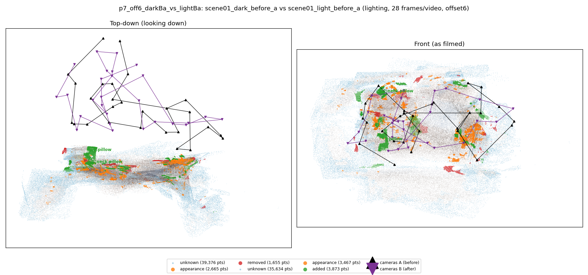
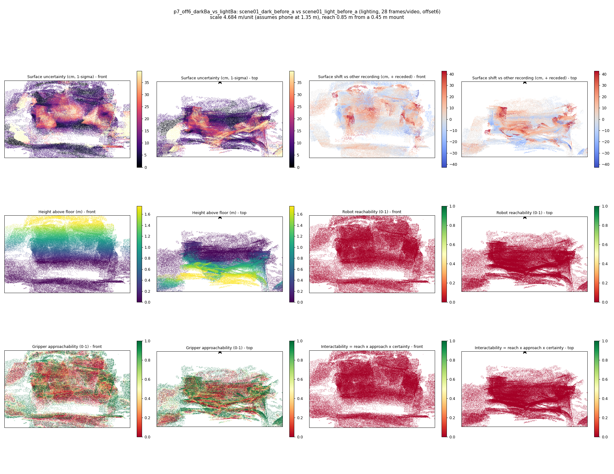

# p7_off6_darkBa_vs_lightBa

**scene01_dark_before_a** (A, before) vs **scene01_light_before_a** (B, after) - pair type **lighting**, 28 frames per video, variant `offset6`.

Distances are in cm, from a floor fit and an assumed phone height (scale 4.6837 m/unit, range [3.8164, 5.5511]).

| Measure | Value |
|---|---|
| Observed share (A / B) | 86.8% / 88.0% |
| Changed share of observed points (A / B) | 1.67% / 2.80% |
| Alignment residual across / within recordings | 0.0399 / 0.0392 |
| Thresholds (depth tau, see-through fraction, appearance) | 0.11811 / 0.71429 / 0.9006 |
| Changes (moved / removed / added / appearance) | 0 / 0 / 2 / 2 |
| Reconstruction time | 27.1 s (GPU peak 9.57 GB) |

Nothing was moved between these recordings, so every flagged point is a false change: **false-change rate 2.24%**.

Heat maps (recording B): reachable 0%, approachable 34%, interactable 0%; surface uncertainty median 8.921 cm (90th pct 29.82); surface shift 99th pct 42.574 cm.

## Changes

- **1 added** pillow (p=0.075, 994 pts, centroid +/- 0.027): A pillow appears in the second recording that was not there before.
- **0 appearance** guitar (p=0.991, 853 pts, centroid +/- 0.027): The guitar looks different (turned over, deformed or swapped) but occupies the same place.
- **3 appearance** cup (p=0.621, 848 pts, centroid +/- 0.027): The cup looks different (turned over, deformed or swapped) but occupies the same place.
- **2 added** neck pillow (p=0.136, 710 pts, centroid +/- 0.027): A neck pillow appears in the second recording that was not there before.
