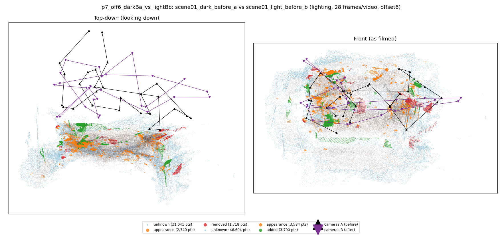
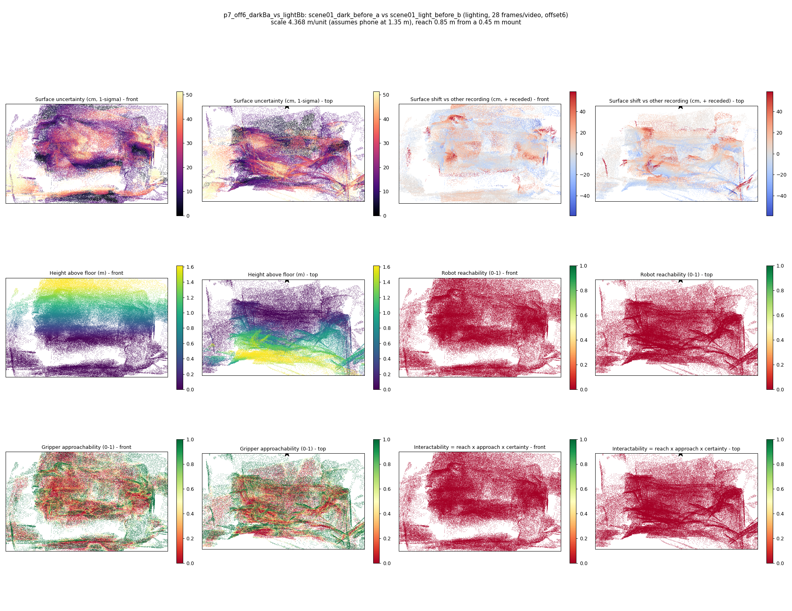

# p7_off6_darkBa_vs_lightBb

**scene01_dark_before_a** (A, before) vs **scene01_light_before_b** (B, after) - pair type **lighting**, 28 frames per video, variant `offset6`.

Distances are in cm, from a floor fit and an assumed phone height (scale 4.3684 m/unit, range [3.5594, 5.1773]).

| Measure | Value |
|---|---|
| Observed share (A / B) | 89.6% / 84.4% |
| Changed share of observed points (A / B) | 1.67% / 2.94% |
| Alignment residual across / within recordings | 0.0511 / 0.0508 |
| Thresholds (depth tau, see-through fraction, appearance) | 0.15261 / 0.71429 / 0.90079 |
| Changes (moved / removed / added / appearance) | 0 / 0 / 1 / 1 |
| Reconstruction time | 26.0 s (GPU peak 9.57 GB) |

Nothing was moved between these recordings, so every flagged point is a false change: **false-change rate 2.30%**.

Heat maps (recording B): reachable 0%, approachable 36%, interactable 0%; surface uncertainty median 15.065 cm (90th pct 42.991); surface shift 99th pct 58.796 cm.

## Changes

- **0 added** hat (p=0.149, 1345 pts, centroid +/- 0.036): A hat appears in the second recording that was not there before.
- **1 appearance** hat (p=0.242, 805 pts, centroid +/- 0.036): The hat looks different (turned over, deformed or swapped) but occupies the same place.
