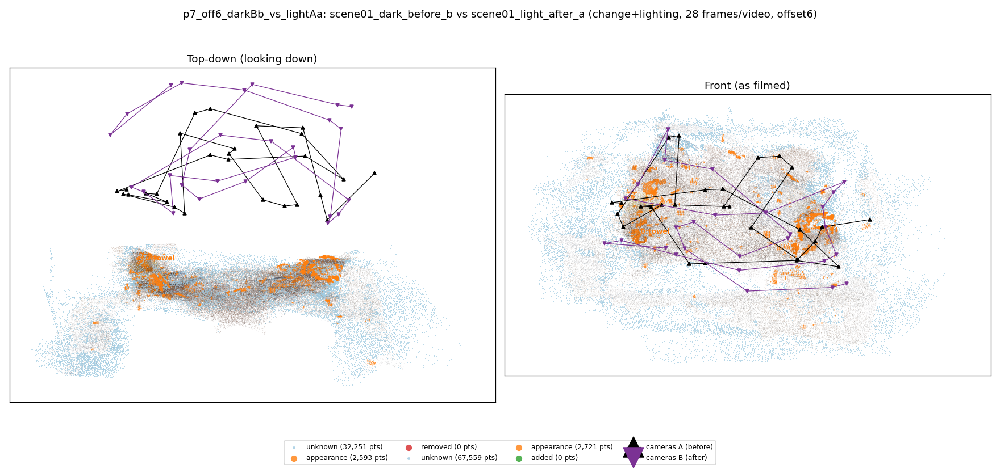
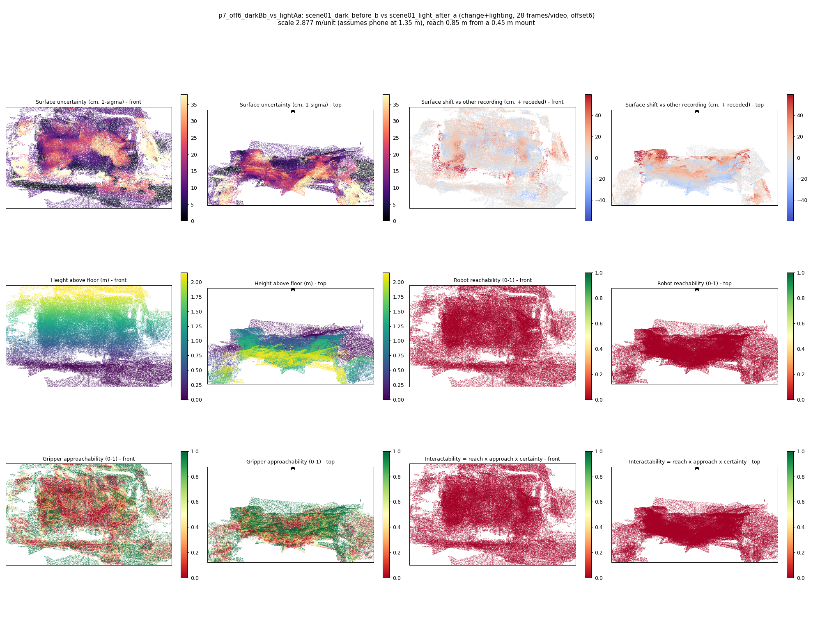

# p7_off6_darkBb_vs_lightAa

**scene01_dark_before_b** (A, before) vs **scene01_light_after_a** (B, after) - pair type **change+lighting**, 28 frames per video, variant `offset6`.

Distances are in cm, from a floor fit and an assumed phone height (scale 2.8765 m/unit, range [2.3438, 3.4092]).

| Measure | Value |
|---|---|
| Observed share (A / B) | 89.1% / 77.3% |
| Changed share of observed points (A / B) | 0.98% / 1.19% |
| Alignment residual across / within recordings | 0.0382 / 0.0384 |
| Thresholds (depth tau, see-through fraction, appearance) | 0.11473 / 1.0 / 0.89675 |
| Changes (moved / removed / added / appearance) | 0 / 0 / 0 / 1 |
| Reconstruction time | 25.6 s (GPU peak 9.57 GB) |

Heat maps (recording B): reachable 0%, approachable 35%, interactable 0%; surface uncertainty median 9.399 cm (90th pct 29.315); surface shift 99th pct 59.728 cm.

## Changes

- **0 appearance** towel (p=0.053, 920 pts, centroid +/- 0.037): The towel looks different (turned over, deformed or swapped) but occupies the same place.
