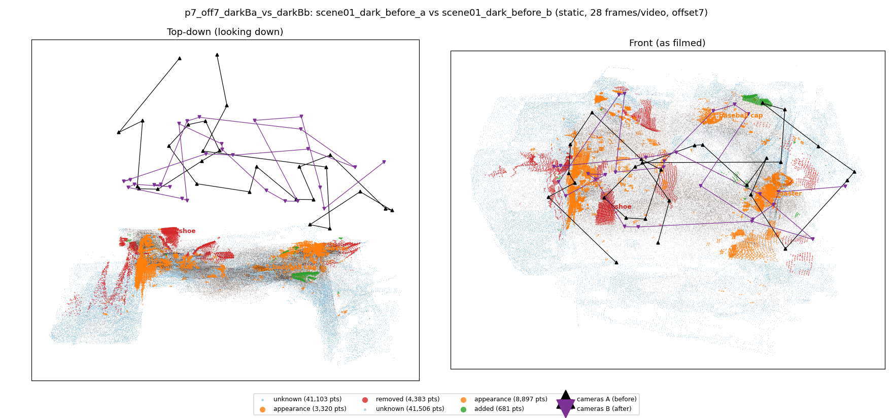
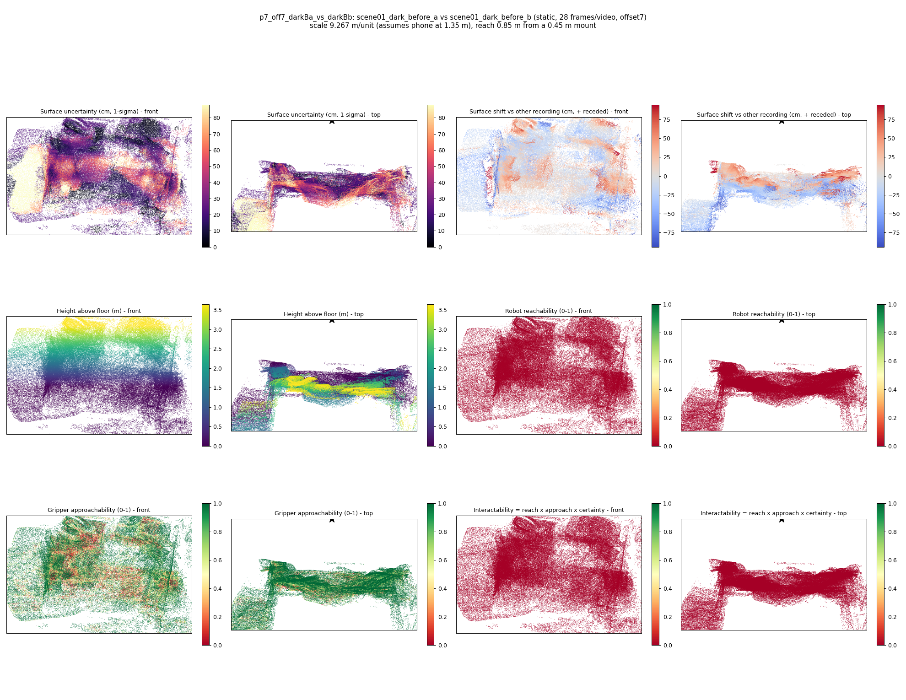

# p7_off7_darkBa_vs_darkBb

**scene01_dark_before_a** (A, before) vs **scene01_dark_before_b** (B, after) - pair type **static**, 28 frames per video, variant `offset7`.

Distances are in cm, from a floor fit and an assumed phone height (scale 9.2666 m/unit, range [7.5506, 10.9827]).

| Measure | Value |
|---|---|
| Observed share (A / B) | 86.7% / 86.8% |
| Changed share of observed points (A / B) | 2.87% / 3.50% |
| Alignment residual across / within recordings | 0.0485 / 0.0482 |
| Thresholds (depth tau, see-through fraction, appearance) | 0.14521 / 0.75 / 0.89777 |
| Changes (moved / removed / added / appearance) | 0 / 1 / 0 / 3 |
| Reconstruction time | 26.1 s (GPU peak 9.57 GB) |

Nothing was moved between these recordings, so every flagged point is a false change: **false-change rate 3.18%**.

Heat maps (recording B): reachable 0%, approachable 59%, interactable 0%; surface uncertainty median 22.488 cm (90th pct 65.264); surface shift 99th pct 94.208 cm.

## Changes

- **3 appearance** door (p=0.126, 3886 pts, centroid +/- 0.034): The door looks different (turned over, deformed or swapped) but occupies the same place.
- **2 appearance** coaster (p=0.204, 2401 pts, centroid +/- 0.034): The coaster looks different (turned over, deformed or swapped) but occupies the same place.
- **0 removed** shoe (p=0.149, 1089 pts, centroid +/- 0.034): A shoe that was there in the first recording is no longer there.
- **1 appearance** baseball cap (p=0.493, 619 pts, centroid +/- 0.034): The baseball cap looks different (turned over, deformed or swapped) but occupies the same place.
