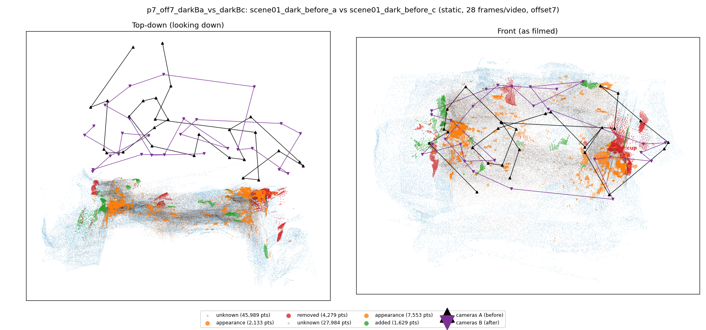
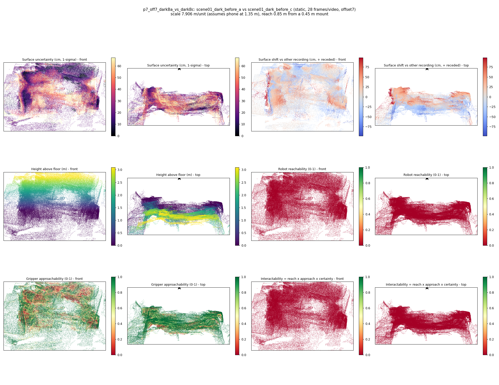

# p7_off7_darkBa_vs_darkBc

**scene01_dark_before_a** (A, before) vs **scene01_dark_before_c** (B, after) - pair type **static**, 28 frames per video, variant `offset7`.

Distances are in cm, from a floor fit and an assumed phone height (scale 7.906 m/unit, range [6.4419, 9.37]).

| Measure | Value |
|---|---|
| Observed share (A / B) | 85.1% / 91.0% |
| Changed share of observed points (A / B) | 2.43% / 3.27% |
| Alignment residual across / within recordings | 0.061 / 0.0574 |
| Thresholds (depth tau, see-through fraction, appearance) | 0.17216 / 0.75 / 0.91327 |
| Changes (moved / removed / added / appearance) | 0 / 1 / 0 / 3 |
| Reconstruction time | 26.5 s (GPU peak 9.57 GB) |

Nothing was moved between these recordings, so every flagged point is a false change: **false-change rate 2.85%**.

Heat maps (recording B): reachable 0%, approachable 54%, interactable 0%; surface uncertainty median 21.413 cm (90th pct 53.598); surface shift 99th pct 98.166 cm.

## Changes

- **0 removed** cup (p=0.579, 2752 pts, centroid +/- 0.039): A cup that was there in the first recording is no longer there.
- **1 appearance** bag (p=0.267, 2230 pts, centroid +/- 0.039): The bag looks different (turned over, deformed or swapped) but occupies the same place.
- **3 appearance** cup (p=0.568, 2224 pts, centroid +/- 0.039): The cup looks different (turned over, deformed or swapped) but occupies the same place.
- **2 appearance** cup (p=0.601, 644 pts, centroid +/- 0.039): The cup looks different (turned over, deformed or swapped) but occupies the same place.
