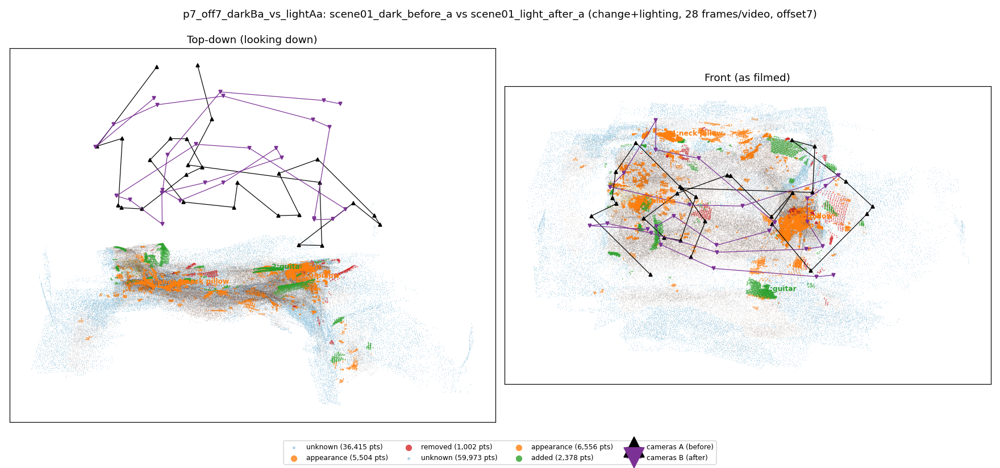
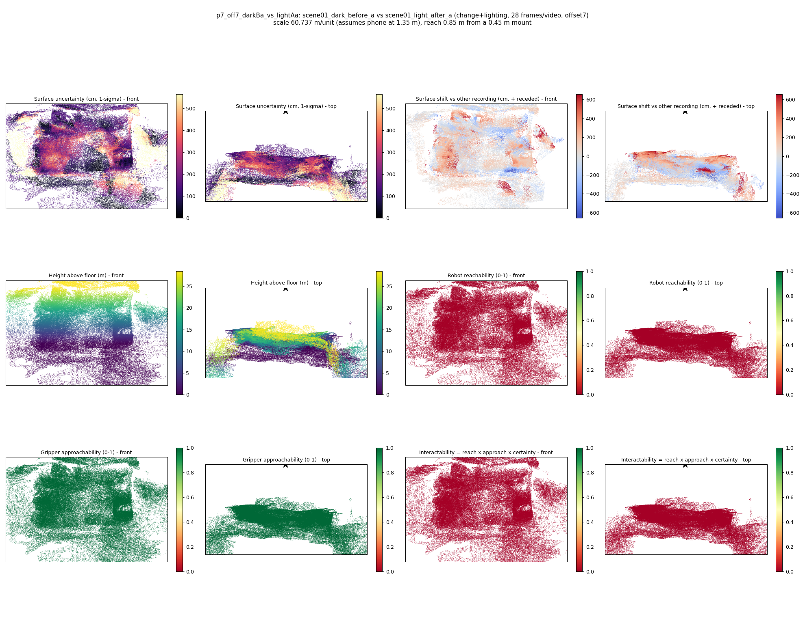

# p7_off7_darkBa_vs_lightAa

**scene01_dark_before_a** (A, before) vs **scene01_light_after_a** (B, after) - pair type **change+lighting**, 28 frames per video, variant `offset7`.

Distances are in cm, from a floor fit and an assumed phone height (scale 60.7367 m/unit, range [49.4892, 71.9843]).

| Measure | Value |
|---|---|
| Observed share (A / B) | 87.8% / 79.8% |
| Changed share of observed points (A / B) | 2.49% / 3.76% |
| Alignment residual across / within recordings | 0.0439 / 0.0419 |
| Thresholds (depth tau, see-through fraction, appearance) | 0.12572 / 0.85333 / 0.89893 |
| Changes (moved / removed / added / appearance) | 0 / 0 / 1 / 4 |
| Reconstruction time | 25.7 s (GPU peak 9.57 GB) |

Heat maps (recording B): reachable 0%, approachable 100%, interactable 0%; surface uncertainty median 136.226 cm (90th pct 386.423); surface shift 99th pct 655.752 cm.

## Changes

- **3 appearance** cup (p=0.62, 2741 pts, centroid +/- 0.030): The cup looks different (turned over, deformed or swapped) but occupies the same place.
- **0 appearance** pillow (p=0.179, 1512 pts, centroid +/- 0.030): The pillow looks different (turned over, deformed or swapped) but occupies the same place.
- **4 appearance** neck pillow (p=0.4, 807 pts, centroid +/- 0.030): The neck pillow looks different (turned over, deformed or swapped) but occupies the same place.
- **2 added** guitar (p=0.989, 733 pts, centroid +/- 0.030): A guitar appears in the second recording that was not there before.
- **1 appearance** phone (p=0.09, 676 pts, centroid +/- 0.030): The phone looks different (turned over, deformed or swapped) but occupies the same place.
