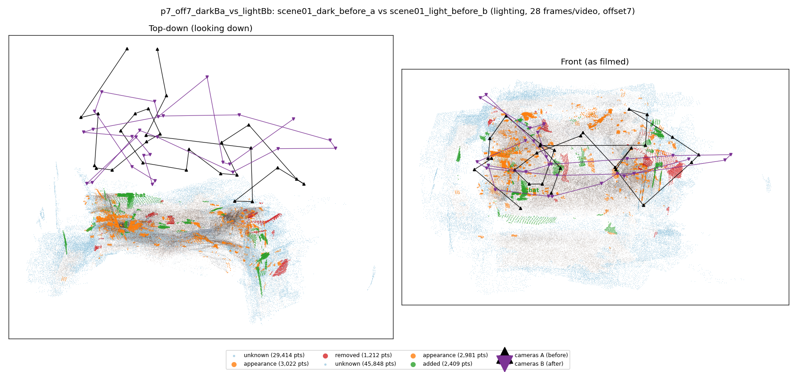
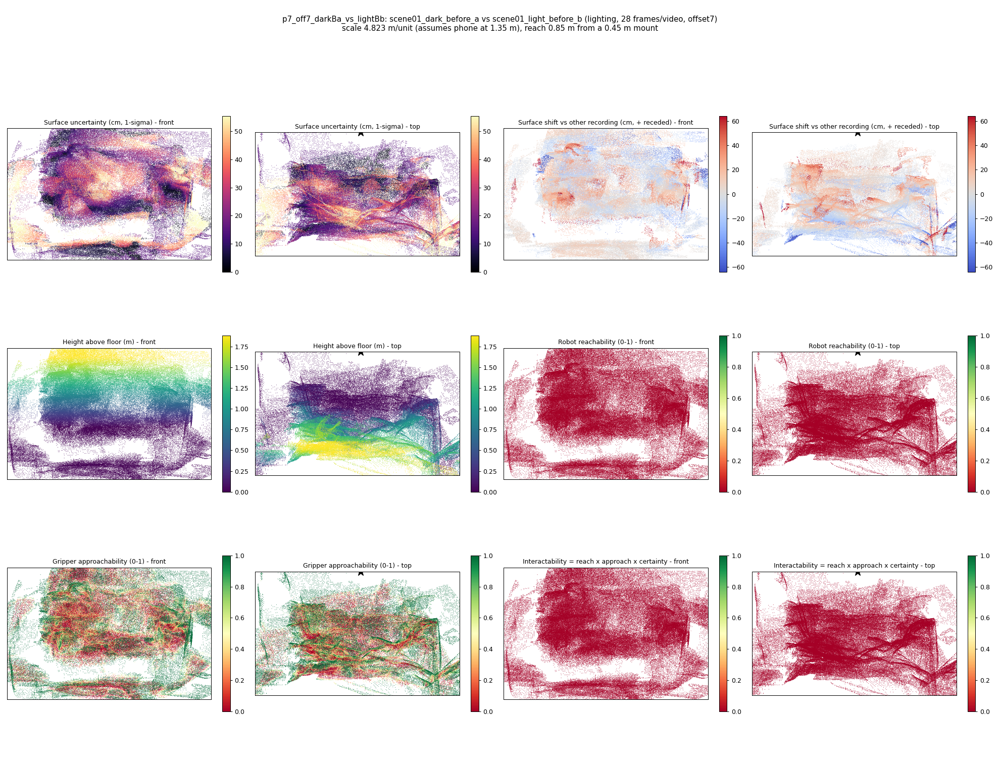

# p7_off7_darkBa_vs_lightBb

**scene01_dark_before_a** (A, before) vs **scene01_light_before_b** (B, after) - pair type **lighting**, 28 frames per video, variant `offset7`.

Distances are in cm, from a floor fit and an assumed phone height (scale 4.8229 m/unit, range [3.9298, 5.716]).

| Measure | Value |
|---|---|
| Observed share (A / B) | 90.1% / 84.6% |
| Changed share of observed points (A / B) | 1.58% / 2.14% |
| Alignment residual across / within recordings | 0.0498 / 0.0504 |
| Thresholds (depth tau, see-through fraction, appearance) | 0.15047 / 0.75 / 0.90381 |
| Changes (moved / removed / added / appearance) | 0 / 0 / 1 / 1 |
| Reconstruction time | 27.9 s (GPU peak 9.57 GB) |

Nothing was moved between these recordings, so every flagged point is a false change: **false-change rate 1.86%**.

Heat maps (recording B): reachable 0%, approachable 39%, interactable 0%; surface uncertainty median 15.827 cm (90th pct 46.455); surface shift 99th pct 64.138 cm.

## Changes

- **0 appearance** book (p=0.573, 813 pts, centroid +/- 0.036): The book looks different (turned over, deformed or swapped) but occupies the same place.
- **1 added** hat (p=0.12, 619 pts, centroid +/- 0.036): A hat appears in the second recording that was not there before.
