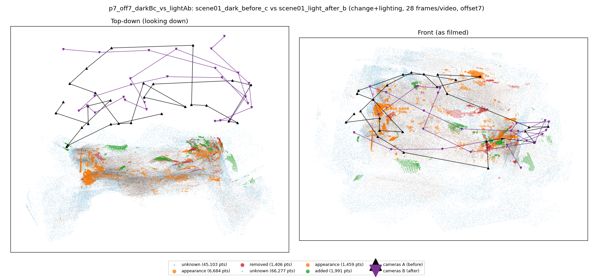
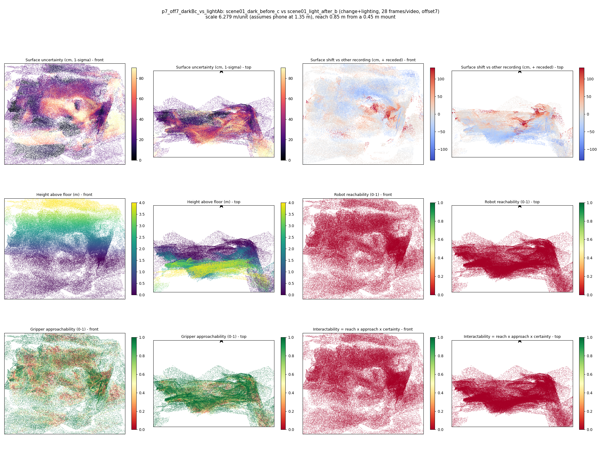

# p7_off7_darkBc_vs_lightAb

**scene01_dark_before_c** (A, before) vs **scene01_light_after_b** (B, after) - pair type **change+lighting**, 28 frames per video, variant `offset7`.

Distances are in cm, from a floor fit and an assumed phone height (scale 6.2788 m/unit, range [5.1161, 7.4416]).

| Measure | Value |
|---|---|
| Observed share (A / B) | 84.8% / 77.7% |
| Changed share of observed points (A / B) | 3.21% / 1.49% |
| Alignment residual across / within recordings | 0.0537 / 0.0514 |
| Thresholds (depth tau, see-through fraction, appearance) | 0.15399 / 0.75 / 0.91536 |
| Changes (moved / removed / added / appearance) | 0 / 0 / 0 / 2 |
| Reconstruction time | 28.3 s (GPU peak 9.57 GB) |

Heat maps (recording B): reachable 0%, approachable 56%, interactable 0%; surface uncertainty median 25.106 cm (90th pct 72.07); surface shift 99th pct 131.489 cm.

## Changes

- **0 appearance** glass vase (p=0.47, 1912 pts, centroid +/- 0.052): The glass vase looks different (turned over, deformed or swapped) but occupies the same place.
- **1 appearance** guitar (p=0.989, 773 pts, centroid +/- 0.052): The guitar looks different (turned over, deformed or swapped) but occupies the same place.
